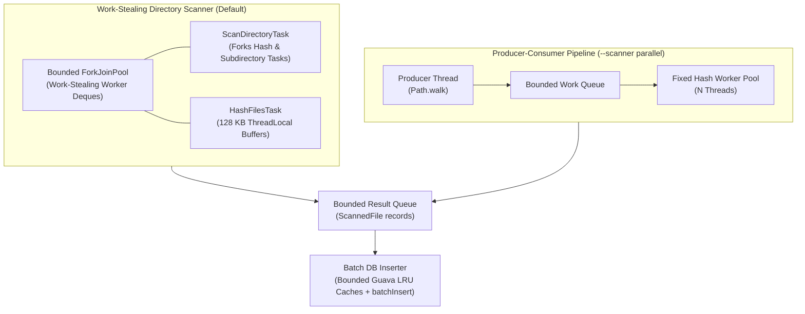
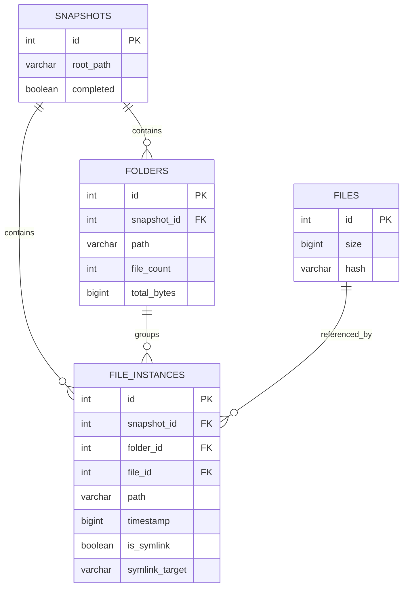

# Boveda

A vault of documents, images, and other files. Boveda scans directory hierarchies, computes fast content fingerprints, records file and folder snapshots into an SQL database using [JetBrains Exposed](https://github.com/JetBrains/Exposed), and runs analytical queries such as file-level and folder-pair duplicate detection and interactive duplicate cleanup.

---

## Features

- **Decoupled CLI Commands (`scan` and `db`)**: Clean separation between directory scanning / database population (`scan`) and offline analytical database querying and cleanup (`db`, `db file print-duplicates`, `db file delete`, `db folder print-duplicates`, `db folder delete`, `db snapshots list`, `db snapshots delete`).
- **Resume Incomplete Scans (`scan --continue <snapshot_id>`)**: If a scan is interrupted or terminated midway, resume where it left off using the snapshot ID. The root directory is retrieved directly from the snapshot, and files already processed with matching path, name, timestamp, and size are skipped without recomputing hashes.
- **Work-Stealing Parallel Directory Scanner**: Concurrently explores directory branches across a strictly bounded `ForkJoinPool`, dynamically balancing subdirectory traversal and file hashing tasks via thread-local deques to maximize throughput on NVMe SSDs and multi-core CPUs without thread storms.
- **Multi-Threaded Producer-Consumer Pipeline**: Optional producer-consumer strategy (`--scanner parallel`) decoupling directory walking (Stage 1), parallel hashing across a fixed worker pool (Stage 2), and database persistence (Stage 3) via bounded queues.
- **Streaming File Hashing & Prefix-Only Option (`--max-hash-bytes`)**: Reusable 128 KB per-thread buffers with high-speed non-cryptographic (`XXH3` default, `XXH3_128`, `XXH64`, `XXH32`, `CRC32`, `CRC32C`) and cryptographic (`MD5`, `SHA-256`, `SHA-512`, etc.) hashing. Supports optional prefix hashing (`64Kb`, `128Kb`, `256Kb`, `512Kb`, `1Mb`, or `full`) combined with file size for rapid comparison of large files.
- **Content-Addressable Storage & Bounded LRU Caches**: File content records (`files`) are deduplicated by `(size, hash)`, with folder aggregates (`folders`) and file instance records (`file_instances`) linking snapshots to files. Bounded Guava LRU caches (250k file content entries, 50k folder entries), a 16 MB H2 page cache limit, and default JVM memory limits (`-Xmx1g -XX:MaxMetaspaceSize=128m -Xss256k`, overridable via `BOVEDA_OPTS`) keep memory usage predictable on multi-million-file scans.
- **High-Throughput Batch Ingestion**: Buffers scanned files into configurable batch sizes (default `1000` files/transaction) and issues optimized SQL `batchInsert` operations.
- **File-Level Duplication Statistics (`db file print-duplicates`)**: Uses SQL window functions (`ROW_NUMBER() OVER(PARTITION BY hash ORDER BY path)`) and outputs a statistical report including total files/storage scanned, wasted duplicate storage, top 10 duplicate groups ordered by combined duplicate space, and a Mordant-rendered 10% percentile deciles table.
- **Folder-Level Duplicate Analysis (`db folder print-duplicates`)**: Identifies top folder pairs sharing duplicate files, showing shared vs. differing file counts, duplicated storage percentages, and the largest duplicated files in each pair.
- **Safe & Interactive Duplicate Deletion (`db file delete`, `db folder delete`)**: Delete specific duplicate files or 100% matching duplicate folders from disk and database (refusing to delete non-duplicated entries unless `--force` is passed) or launch interactive terminal selectors to reclaim space starting from the largest duplicate groups.
- **Cross-Platform Symbolic Link Support (Linux, macOS, Windows)**: Symbolic links are recorded using their actual link size (never following targets or treating symlinks as duplicates). Duplicate reports (`db file print-duplicates`, `db folder print-duplicates`) and interactive deletion selectors (`db file delete`, `db folder delete`) display associated symlinks clearly marked as `[symlink -> <target>]`, allowing you to delete just the symlink while preserving its target file or folder.
- **Snapshot Management (`db snapshots list`, `db snapshots delete`)**: Inspect all recorded snapshots in a formatted table showing snapshot ID, root path, file counts, total storage size, and completion status, or delete snapshots with automatic cascade cleanup of orphaned records.
- **Pre-Scan Estimation & Live Mordant Progress Bar**: Displays an animated estimation spinner before scanning (skippable via `--no-estimate`) and, during `--quiet` scans, a throttled Mordant progress bar showing percentage, ETA, processed file counts, and live ingestion speeds (files/s and MB/s).
- **Rich CLI with Clikt & GraalVM Native Image Ready**: Structured subcommand CLI with path validation, runtime log-level control, and GraalVM Native Image metadata for compiling a standalone native binary.
- **Flexible Storage**: Supports both in-memory H2 databases (for tests) and persistent file-backed H2 databases (`.mv.db`).

---

## Prerequisites

- **Java Development Kit (JDK)**: Java 22 (or toolchain provisioned via Gradle)
- **Gradle**: Wrapper included (`./gradlew`)

---

## Installation & Build

Build the project, run verification checks, or install the runnable distribution:

```bash
# Build the project
./gradlew build

# Run unit and integration tests
./gradlew test

# Run ktlint, tests, and Kover code coverage checks
./gradlew check

# Build the runnable CLI distribution under build/install/boveda/
./gradlew installDist
./build/install/boveda/bin/boveda --help

# Override JVM memory limits at runtime via BOVEDA_OPTS (default: -Xmx1g -XX:MaxMetaspaceSize=128m -Xss256k)
BOVEDA_OPTS="-Xmx512m" ./build/install/boveda/bin/boveda scan /path/to/dir /tmp/vault.db --quiet

# Build standalone GraalVM Native Image executable
./gradlew nativeCompile
./build/native/nativeCompile/boveda --help

# Or compile and run native image directly with Gradle
./gradlew nativeRun --args="--help"
```

---

## CLI Structure & Usage

Boveda provides two top-level subcommands: **`scan`** and **`db`** (which organizes offline operations under **`file`**, **`folder`**, and **`snapshots`**).

```text
Usage: boveda [<options>] <command> [<args>]...

  Boveda: File vault fingerprinting, deduplication scanner, and analytical
  database querying.

Options:
  -l, --log-level=(OFF|ERROR|WARN|WARNING|INFO|DEBUG|TRACE)
              Logging level (OFF, ERROR, WARN, INFO, DEBUG, TRACE). Default is WARN.
  -h, --help  Show this message and exit

Commands:
  scan  Scan directory and populate the target database with file fingerprints.
  db    Query an already existing/computed database.
```

### 1. `scan` Subcommand

Scans a directory tree, computes file content hashes, and populates the target database with a new (or resumed) snapshot:

```text
Usage: boveda scan [<options>] [<directory>] [<database>]

  Scan directory and populate the target database with file fingerprints.

Options:
  -c, --continue=<int>    Resume an incomplete directory scan for the given
                          snapshot ID.
  -d, --db=<path>         Target database file path.
  -a, --algorithm=<text>  File hashing algorithm (e.g. XXH3, CRC32, MD5,
                          SHA-256, SHA-512). Default is XXH3.
  -m, --max-hash-bytes, --max-hash-size, --hash-prefix-size, --hash-bytes=<text>
                          Maximum initial bytes to hash per file as well as the
                          file size (e.g. 64Kb, 128Kb, 256Kb, 512Kb, 1Mb, full).
                          Default is full file.
  -q, --quiet             Suppress per-file progress output during directory
                          scan.
  -b, --batch-size=<int>  Number of files to batch per database transaction
                          during scanning. Default is 1000.
  -t, --threads=<int>     Number of worker threads for parallel file hashing
                          (defaults to available CPU cores, capped at 8).
  -s, --scanner=(work-stealing|parallel|sequential)
                          Directory scanner strategy: 'work-stealing' (default),
                          'parallel' (producer-consumer pipeline), or
                          'sequential'.
  --work-stealing         Enable work-stealing parallel directory traversal
                          using ForkJoinPool.
  --no-cache-warmup       Disable pre-warming the in-memory deduplication cache
                          from the database on startup.
  --no-estimate           Skip the initial directory traversal that estimates
                          total file count and size.
  --db-cache-mb=<int>     H2 in-memory page cache size in MB during scanning.
                          Default is 64.
  -l, --log-level=(OFF|ERROR|WARN|WARNING|INFO|DEBUG|TRACE)
                          Logging level (OFF, ERROR, WARN, INFO, DEBUG, TRACE).
  -h, --help              Show this message and exit

Arguments:
  <directory>  Directory path to scan (optional when --continue is provided).
  <database>   Target database file path.
```

#### Best Scan Options & Hashing Strategy Guide

For the full empirical benchmark report across large files (100 MB – 1 GB) and prefix limits, see [hashing_benchmark_report.md](hashing_benchmark_report.md).

| Requirement / Circumstance | Recommended Scan Options | Rationale |
| :--- | :--- | :--- |
| **General Deduplication (Default)** | `boveda scan <dir> <db>` *(defaults to `--algorithm XXH3`)* | **2.7–3.0 GB/s** hashing rate on NVMe; 64-bit entropy protects against accidental collisions. Safe for deduplication reports. |
| **Terabyte-Scale Storage / Large Media & ISOs** | `boveda scan --max-hash-bytes 1Mb <dir> <db>` | **~500x speedup** on large files (1 GB hashed in **0.69 ms**). Combines the first 1 MB prefix with the exact file size to eliminate disk read bottlenecks. |
| **Safe Deletion Workflows (`db file delete`)** | `boveda scan --algorithm XXH3 <dir> <db>` *(Full hashing, omit `--max-hash-bytes`)* | Full content hashing ensures distinct files sharing identical headers or sizes are never falsely matched. **Never use CRC32 for deletion.** |
| **Cloud / Amazon S3 / Legacy Manifests** | `boveda scan --algorithm MD5 <dir> <db>` | Generates 128-bit MD5 hex digests matching Amazon S3 ETags, `rsync --checksum`, and `md5sum` registries. |
| **Low-Power / Memory-Constrained / WSL2 Large Trees** | `BOVEDA_OPTS="-Xmx512m" boveda scan --no-estimate --max-hash-bytes 64Kb <dir> <db>` | Skips the double-walk estimation pass, minimizes I/O and CPU cycles, and bounds JVM memory cleanly. |

> [!WARNING]
> **Why CRC32 must NEVER be used for deletion workflows:**
> `CRC32` produces only a 32-bit checksum. Under the Birthday paradox, there is a **50% probability of an accidental hash collision at just ~77,000 files**. In a repository with 100k+ files, CRC32 will falsely flag distinct files as duplicates. If `db file delete` is executed on a CRC32 database, distinct user files could be permanently deleted! Always use `XXH3` (or `SHA-256`/`MD5`) for deduplication and deletion workflows.

### 2. `db` Subcommand

Queries an existing database without scanning the filesystem. If invoked without a nested subcommand, it prints all recorded file records from the latest snapshot. The `<database>` path and `--snapshot` option can be provided either on `db` (or `db file` / `db folder`) or on the leaf subcommand:

```text
Usage: boveda db [<options>] [<database>] <command> [<args>]...

  Query an already existing/computed database.

Options:
  -d, --db=<path>       Path to persistent H2 database file.
  -s, --snapshot=<int>  Optional snapshot ID to query. Defaults to the latest
                        snapshot.
  -l, --log-level=(OFF|ERROR|WARN|WARNING|INFO|DEBUG|TRACE)
                        Logging level (OFF, ERROR, WARN, INFO, DEBUG, TRACE).
  -h, --help            Show this message and exit

Arguments:
  <database>  Path to persistent H2 database file.

Commands:
  snapshots  Manage database snapshots (list, delete).
  file       Manage and analyze database files (print-duplicates, delete).
  folder     Manage and analyze folders in the database.
```

### 3. `db file print-duplicates` Subcommand

Queries the database for duplicate files (files sharing identical content hashes within a snapshot) and prints duplication overview metrics, the top 10 duplicate groups ordered by combined duplicate space, and a Mordant percentile decile table:

```text
Usage: boveda db file print-duplicates [<options>] [<database>]
# or: boveda db [<database>] file print-duplicates [<options>]

  Query the provided database for the latest snapshot and print duplicate files
  and statistics.

Options:
  -d, --db=<path>       Path to persistent H2 database file.
  -s, --snapshot=<int>  Optional snapshot ID to query. Defaults to the latest
                        snapshot.
  -v, --verbose         Print every duplicate file entry found in the database.
  -l, --log-level=(OFF|ERROR|WARN|WARNING|INFO|DEBUG|TRACE)
                        Logging level (OFF, ERROR, WARN, INFO, DEBUG, TRACE).
  -h, --help            Show this message and exit

Arguments:
  <database>  Path to persistent H2 database file.
```

### 4. `db file delete` Subcommand

Deletes duplicate files from both disk and the database snapshot, automatically cleaning up orphaned CAS records when all references to a file's content are removed:

- **Single-File Mode**: If a file path is specified, deletes it from disk and database, but only if duplicate copies exist (or if `--force` is specified).
- **Interactive Mode**: If no file path is specified, finds the duplicate group wasting the most storage and provides an interactive terminal multi-select prompt (<kbd>↑</kbd>/<kbd>↓</kbd> navigate, <kbd>Space</kbd>/<kbd>x</kbd> toggle, <kbd>a</kbd> toggle all, <kbd>Enter</kbd> delete selected, <kbd>Esc</kbd> quit), looping to the next largest group until resolved or exited.

```text
Usage: boveda db file delete [<options>] [<file>] [<database>]
# or: boveda db [<database>] file delete [<file>] [<options>]

  Delete duplicate files from the filesystem and database.

Options:
  -f, --file=<path>     Path to file to delete.
  -d, --db=<path>       Path to persistent H2 database file.
  --force               Force deletion of file even if it does not have
                        duplicates.
  -s, --snapshot=<int>  Optional snapshot ID to query. Defaults to the latest
                        snapshot.
  -l, --log-level=(OFF|ERROR|WARN|WARNING|INFO|DEBUG|TRACE)
                        Logging level (OFF, ERROR, WARN, INFO, DEBUG, TRACE).
  -h, --help            Show this message and exit

Arguments:
  <file>      Path to file to delete (optional; if omitted, starts interactive
              duplicate deletion).
  <database>  Path to persistent H2 database file.
```

### 5. `db folder print-duplicates` Subcommand

Finds the top folder pairs sharing the most duplicated content within a snapshot, reporting shared/different file counts, duplicate storage share percentages, and up to the top 3 largest duplicate files per pair:

```text
Usage: boveda db folder print-duplicates [<options>] [<database>]
# or: boveda db [<database>] folder print-duplicates [<options>]

  Show top folder pairs with most duplicate files between them and duplicate
  statistics.

Options:
  -d, --db=<path>       Path to persistent H2 database file.
  -s, --snapshot=<int>  Optional snapshot ID to query. Defaults to the latest
                        snapshot.
  -n, --limit=<int>     Number of top duplicate folder pairs to show. Default is
                        10.
  -l, --log-level=(OFF|ERROR|WARN|WARNING|INFO|DEBUG|TRACE)
                        Logging level (OFF, ERROR, WARN, INFO, DEBUG, TRACE).
  -h, --help            Show this message and exit

Arguments:
  <database>  Path to persistent H2 database file.
```

### 6. `db folder delete` Subcommand

Deletes 100% matching duplicate folders (folders containing the exact same identical files with no extra files or subfolders) from disk and the database snapshot, automatically cleaning up orphaned CAS records:

- **Single-Folder Mode**: If a folder path is specified, deletes its recorded files and removes the folder from disk (if empty) and database, only if a 100% matching duplicate folder exists (or if `--force` is specified).
- **Interactive Mode**: If no folder path is specified, finds the largest 100% matching duplicate folder group and provides an interactive terminal multi-select prompt (<kbd>↑</kbd>/<kbd>↓</kbd> navigate, <kbd>Space</kbd>/<kbd>x</kbd> toggle, <kbd>a</kbd> toggle all, <kbd>s</kbd> skip, <kbd>Enter</kbd> delete selected, <kbd>Esc</kbd> quit), looping through all 100% matching groups.

```text
Usage: boveda db folder delete [<options>] [<folder>] [<database>]
# or: boveda db [<database>] folder delete [<folder>] [<options>]

  Delete 100% matching duplicate folders from the filesystem and database.

Options:
  -f, --folder=<path>   Path to folder to delete.
  -d, --db=<path>       Path to persistent H2 database file.
  --force               Force deletion of folder even if it does not have a
                        100% matching duplicate.
  -s, --snapshot=<int>  Optional snapshot ID to query. Defaults to the latest
                        snapshot.
  -l, --log-level=(OFF|ERROR|WARN|WARNING|INFO|DEBUG|TRACE)
                        Logging level (OFF, ERROR, WARN, INFO, DEBUG, TRACE).
  -h, --help            Show this message and exit

Arguments:
  <folder>    Path to folder to delete (optional; if omitted, starts
              interactive duplicate deletion).
  <database>  Path to persistent H2 database file.
```

### 7. `db snapshots list` Subcommand

Lists all recorded snapshots in the database in a formatted table showing snapshot ID, root path, file count, total storage size, and completion status:

```text
Usage: boveda db snapshots list [<options>] [<database>]
# or: boveda db [<database>] snapshots list [<options>]

  List all snapshots stored in the database.

Options:
  -d, --db=<path>  Path to persistent H2 database file.
  -l, --log-level=(OFF|ERROR|WARN|WARNING|INFO|DEBUG|TRACE)
                   Logging level (OFF, ERROR, WARN, INFO, DEBUG, TRACE).
  -h, --help       Show this message and exit

Arguments:
  <database>  Path to persistent H2 database file.
```

### 8. `db snapshots delete` Subcommand

Deletes a snapshot by its ID from the database, cascading to remove its folders, file instances, and any orphaned content records no longer referenced by other snapshots:

```text
Usage: boveda db snapshots delete [<options>] <snapshot_id> [<database>]
# or: boveda db [<database>] snapshots delete <snapshot_id> [<options>]

  Delete a snapshot from the database by its snapshot ID.

Options:
  -d, --db=<path>  Path to persistent H2 database file.
  -l, --log-level=(OFF|ERROR|WARN|WARNING|INFO|DEBUG|TRACE)
                   Logging level (OFF, ERROR, WARN, INFO, DEBUG, TRACE).
  -h, --help       Show this message and exit

Arguments:
  <snapshot_id>  ID of the snapshot to delete.
  <database>     Path to persistent H2 database file.
```

---

## Examples

*(Examples below use `./gradlew run --args="..."`; after `./gradlew installDist`, you can invoke `./build/install/boveda/bin/boveda ...` directly.)*

### 1. Scan a Directory and Populate a Database
Scan `/path/to/my/documents` and record all file fingerprints into `/tmp/vault.db`:
```bash
./gradlew run --args="scan /path/to/my/documents /tmp/vault.db"
```
*(Creates the H2 database file at `/tmp/vault.db.mv.db`.)*

### 2. Quiet Scan with Live Progress Indicator
Suppress per-file terminal output and display an animated Mordant progress bar with percentage, ETA, and real-time ingestion speeds:
```bash
./gradlew run --args="scan --quiet /path/to/my/documents /tmp/vault.db"

# Skip initial metadata estimation pass on very large directory trees
./gradlew run --args="scan --quiet --no-estimate /path/to/my/documents /tmp/vault.db"
```
During scanning:
```text
⠋ Scanning & ingesting: ━━━━━━━━━━━━━━━━━━━━━━━━━━━━━━ 100% 1,420 / 1,420 files (115.4 files/s, 24.50 MB/s) eta 00:00 0:00:12
```
On completion:
```text
✔ Scanned 1,420 files (450.20 MB) in 12.30s (115.4 files/s, 24.50 MB/s)
```

### 3. Resume an Interrupted Scan
If a scan was stopped before completion, check its ID with `db snapshots list` and resume it:
```bash
./gradlew run --args="scan --continue 1 --quiet /tmp/vault.db"
```

### 4. Query All Files in an Existing Database
Query the latest snapshot in `/tmp/vault.db` without re-scanning the filesystem:
```bash
./gradlew run --args="db /tmp/vault.db"
```

### 5. Query Duplicate Files & Duplication Statistics Report
Analyze the latest snapshot in `/tmp/vault.db` for duplicate files and storage waste:
```bash
# Default: prints top 10 duplicate groups and summary deciles table
./gradlew run --args="db file print-duplicates /tmp/vault.db"
# or equivalently:
./gradlew run --args="db /tmp/vault.db file print-duplicates"

# Verbose: also print every individual duplicate file entry in the database
./gradlew run --args="db file print-duplicates --verbose /tmp/vault.db"
```

Example report output:
```text
================================================================================
                           DUPLICATION SUMMARY
================================================================================
Scan & Ingestion Statistics:
  Total Files Scanned:       4,142 files
  Total Storage Scanned:     130.56 MB
  Unique File Contents:      2,306 files
  Unique Storage:            41.50 MB
  Total Processing Time:     145ms

Duplication Overview:
  Duplicate Content Groups:  412 unique files duplicated
  Duplicate File Instances:  2,248 files (1,836 redundant copies)
  Total Duplicated Storage:  130.56 MB
  Wasted Storage:            89.06 MB
  Wasted Storage Share:      68.21% of total scanned storage

--------------------------------------------------------------------------------
Top 10 Largest Duplicate Files:
--------------------------------------------------------------------------------
 1. 25.40 MB | 2 copies | Combined: 50.80 MB | Wasted: 25.40 MB
    Hash: 4f1a...
    Paths:
      - /data/backup/video1.mp4
      - /data/media/video1.mp4
 2. 12.10 MB | 3 copies | Combined: 36.30 MB | Wasted: 24.20 MB
    Hash: a82c...
    Paths:
      - /data/docs/archive.tar
      - /data/old/archive.tar
      - /data/tmp/archive.tar
 ...

--------------------------------------------------------------------------------
Percentile Buckets by File Size (10% Deciles):
--------------------------------------------------------------------------------
┌────────────┬─────────────────────┬───────┬─────────┬────────────────────┬────────────────┬───────────┐
│ Percentile │     Size Range      │ Files │  Size   │ Duplicated Storage │ Wasted Storage │ Share (%) │
╞════════════╪═════════════════════╪═══════╪═════════╪════════════════════╪════════════════╪═══════════╡
│ 0% - 10%   │ [147 B - 171 B]     │   640 │  8.0 KB │          103.13 KB │       95.17 KB │     0.10% │
│ 10% - 20%  │ [171 B - 171 B]     │ 1,836 │  8.3 KB │          306.60 KB │      298.25 KB │     0.33% │
│ 20% - 30%  │ [171 B - 171 B]     │   390 │  8.5 KB │           65.13 KB │       56.61 KB │     0.06% │
│ 30% - 40%  │ [171 B - 171 B]     │   128 │  8.3 KB │           21.38 KB │       13.03 KB │     0.01% │
│ 40% - 50%  │ [172 B - 10.07 KB]  │   308 │ 74.6 KB │          197.88 KB │      123.25 KB │     0.14% │
│ 50% - 60%  │ [10.09 KB - 18.5 KB]│   111 │748.4 KB │            1.65 MB │      921.56 KB │     1.01% │
│ 60% - 70%  │ [18.56 KB - 24.7 KB]│   105 │  1.1 MB │            2.26 MB │        1.18 MB │     1.33% │
│ 70% - 80%  │ [24.72 KB - 36.2 KB]│   102 │  1.5 MB │            2.91 MB │        1.45 MB │     1.63% │
│ 80% - 90%  │ [36.46 KB - 51.8 KB]│   572 │  2.1 MB │           24.43 MB │       22.30 MB │    25.04% │
│ 90% - 100% │ [52.08 KB - 14.1 MB]│   264 │ 37.7 MB │          100.38 MB │       62.65 MB │    70.35% │
╞════════════╪═════════════════════╪═══════╪═════════╪════════════════════╪════════════════╪═══════════╡
│ Total      │ [147 B - 14.11 MB]  │ 4,142 │ 41.5 MB │          130.56 MB │       89.06 MB │   100.00% │
└────────────┴─────────────────────┴───────┴─────────┴────────────────────┴────────────────┴───────────┘
--------------------------------------------------------------------------------
Total Wasted Storage: 89.06 MB (93,382,389 bytes)
================================================================================
```

### 6. Find Top Duplicate Folder Pairs
Identify directories containing overlapping duplicate copies:
```bash
# Default: top 10 folder pairs
./gradlew run --args="db folder print-duplicates /tmp/vault.db"

# Custom limit
./gradlew run --args="db folder print-duplicates --limit 5 /tmp/vault.db"
```

### 7. Delete Duplicate Files from Disk and Database (`db file delete`)
Delete a specific duplicate file or use the interactive terminal prompt to reclaim space from the largest duplicate groups:
```bash
# Delete a specific duplicate file (fails if it has no duplicates, unless --force is given)
./gradlew run --args="db file delete /data/backup/video1.mp4 /tmp/vault.db"

# Force deletion of any file regardless of duplicate status
./gradlew run --args="db file delete --force /data/backup/old.log /tmp/vault.db"

# Interactive deletion: prompts to select and delete duplicates from the group wasting the most space
./gradlew run --args="db file delete /tmp/vault.db"
```

### 8. Hashing Algorithms (`XXH3`, `CRC32`, `MD5`, `SHA-256`)
Specify a non-cryptographic or cryptographic hashing algorithm:
```bash
# High-performance default non-cryptographic hash (2.7–3.0 GB/s on NVMe)
./gradlew run --args="scan --algorithm XXH3 /path/to/my/documents /tmp/vault.db"

# Amazon S3 ETag compatible MD5 digest (630 MB/s)
./gradlew run --args="scan --algorithm MD5 /path/to/my/documents /tmp/vault.db"

# Hardware-accelerated CRC32 for low-power devices (4.0 GB/s)
./gradlew run --args="scan --algorithm CRC32 /path/to/my/documents /tmp/vault.db"

# Cryptographic SHA-256
./gradlew run --args="scan --algorithm SHA-256 /path/to/my/documents /tmp/vault.db"
```

### 9. Fast Prefix Hashing on Large Files (`--max-hash-bytes`)
Accelerate scanning of large media, video libraries, and archives by hashing only an initial prefix combined with the exact file size (up to 500x speedup):
```bash
# Hash only the first 1 MB per file (combines 1 MB prefix + total file size)
./gradlew run --args="scan --max-hash-bytes 1Mb /path/to/my/videos /tmp/vault.db"

# Ultra-fast 64 KB prefix scan for network shares (NAS)
./gradlew run --args="scan --max-hash-bytes 64Kb /mnt/nas/media /tmp/vault.db"
```

### 10. Multi-Threaded Parallel & Work-Stealing Traversal
Configure worker thread pools and directory exploration strategy:
```bash
# Work-stealing ForkJoinPool scanner with 8 threads (default, capped at 8)
./gradlew run --args="scan --threads 8 --work-stealing /path/to/my/documents /tmp/vault.db"

# Producer-consumer pipeline scanner
./gradlew run --args="scan --scanner parallel --threads 4 /path/to/my/documents /tmp/vault.db"

# Sequential scanner for rotational hard drives
./gradlew run --args="scan --scanner sequential /path/to/my/documents /tmp/vault.db"
```

### 11. High-Throughput Batch Ingestion, Cache & Memory Tuning
Tune database batch transaction sizes, cache warm-up, and JVM memory limits:
```bash
# Ingest in batches of 2,000 files
./gradlew run --args="scan --batch-size 2000 /path/to/my/documents /tmp/vault.db"

# Disable cache pre-warming on memory-constrained systems
./gradlew run --args="scan --no-cache-warmup /path/to/my/documents /tmp/vault.db"

# Cap heap to 512 MB when running the installed CLI distribution
BOVEDA_OPTS="-Xmx512m" ./build/install/boveda/bin/boveda scan --quiet --no-estimate "$HOME" /tmp/vault.db
```

### 12. Query a Specific Snapshot by ID
Query a historical snapshot rather than the default latest snapshot:
```bash
./gradlew run --args="db --snapshot 2 /tmp/vault.db"
./gradlew run --args="db file print-duplicates --snapshot 2 /tmp/vault.db"
./gradlew run --args="db folder print-duplicates --snapshot 2 /tmp/vault.db"
```

### 13. Enable Debug SQL Query Logging
Direct SQL query execution logs to stderr by setting `--log-level=DEBUG`:
```bash
./gradlew run --args="-l DEBUG scan /path/to/my/documents /tmp/vault.db"
```

### 14. List & Delete Database Snapshots
```bash
# List all recorded snapshots
./gradlew run --args="db snapshots list /tmp/vault.db"
# or equivalently:
./gradlew run --args="db /tmp/vault.db snapshots list"

# Delete snapshot 1 and clean up orphaned file records
./gradlew run --args="db snapshots delete 1 /tmp/vault.db"
```

Example `db snapshots list` output:
```text
┌────┬──────────────┬─────────┬────────────┬───────────┐
│ ID │ Root Path    │   Files │ Total Size │  Status   │
╞════╪══════════════╪═════════╪════════════╪═══════════╡
│  1 │ /data/vault1 │   4,142 │  130.56 MB │ Completed │
│  2 │ /data/vault2 │     512 │   15.20 MB │ Completed │
└────┴──────────────┴─────────┴────────────┴───────────┘
```

---

## Architecture Pipeline

Boveda supports both work-stealing tree traversal and producer-consumer pipelining:



1. **Work-Stealing Scanner ([WorkStealingDirectoryScanner](src/main/kotlin/com/cherba29/boveda/scanner/WorkStealingDirectoryScanner.kt))**: Recursively splits directory exploration and file hashing into fine-grained tasks in a strictly thread-bounded `ForkJoinPool`. Hashing tasks execute immediately while idle threads steal subdirectory branches from the deque base.
2. **Producer-Consumer Pipeline ([ParallelDirectoryScanner](src/main/kotlin/com/cherba29/boveda/scanner/ParallelDirectoryScanner.kt))**: Emits files from a single discovery thread into a bounded queue drained by a fixed-size worker pool.
3. **Batch Persistence ([BovedaService](src/main/kotlin/com/cherba29/boveda/service/BovedaService.kt))**: Drains records, resolves content and folder IDs against bounded Guava LRU caches (with transaction-local maps preventing mid-batch eviction issues), and batch inserts records in single transactions.

---

## Database Schema

Boveda uses Exposed to manage an H2 relational schema with four tables:



- **`snapshots`**: Records each scan run with its root path and completion status.
- **`folders`**: Stores normalized folder paths per snapshot along with aggregate unique file counts and byte totals updated on snapshot completion.
- **`files`**: Stores distinct file payloads identified by `(size, hash)`. Identical files across paths and snapshots share a single `files` entry.
- **`file_instances`**: Links a snapshot, folder, and normalized file path (plus optional modification timestamp) to its content record in `files`.

---

## Project Structure

```text
src/main/
├── resources/
│   ├── logback.xml                                  # Logback configuration directing WARN/ERROR logs to stderr
│   └── META-INF/native-image/                       # GraalVM Native Image metadata (reflect, proxy, jni, resource, serialization)
└── kotlin/com/cherba29/boveda/
    ├── Main.kt                                      # Entry point & backward-compatible typealiases
    ├── cmds/
    │   ├── Boveda.kt                                # Root Clikt command (boveda)
    │   ├── Common.kt                                # Shared DB/snapshot resolution helpers
    │   ├── Scan.kt                                  # 'scan' subcommand
    │   ├── Db.kt                                    # 'db' subcommand
    │   └── db/
    │       ├── File.kt                              # 'db file' subcommand group
    │       ├── Folder.kt                            # 'db folder' subcommand group
    │       ├── Snapshots.kt                         # 'db snapshots' subcommand group
    │       ├── file/
    │       │   ├── PrintDuplicates.kt               # 'db file print-duplicates' subcommand
    │       │   ├── Delete.kt                        # 'db file delete' subcommand
    │       │   └── InteractiveDuplicateSelector.kt  # Interactive terminal multi-select duplicate deleter
    │       ├── folder/
    │       │   ├── PrintDuplicates.kt               # 'db folder print-duplicates' subcommand
    │       │   ├── Delete.kt                        # 'db folder delete' subcommand
    │       │   └── InteractiveDuplicateFolderSelector.kt # Interactive 100% matching duplicate folder selector
    │       └── snapshots/
    │           ├── List.kt                          # 'db snapshots list' subcommand
    │           └── Delete.kt                        # 'db snapshots delete' subcommand
    ├── cache/
    │   └── DeduplicationCache.kt                    # Bounded Guava LRU deduplication cache & hit/miss metrics
    ├── hash/
    │   └── FileHasher.kt                            # Streaming file hashing with reusable 128 KB ThreadLocal buffers
    ├── logging/
    │   └── LoggingConfig.kt                         # Logback runtime level configuration
    ├── scanner/
    │   ├── DirectoryMetadata.kt                     # Sequential & work-stealing pre-scan metadata estimators
    │   ├── DiscoveredFile.kt                        # Intermediate discovered file metadata
    │   ├── ScannedFile.kt                           # File metadata DTO (path, size, hash, lastModified, symlink info)
    │   ├── SymlinkUtils.kt                          # Cross-platform symlink target resolution & marker hashing
    │   ├── DirectoryScanner.kt                      # Scanner interface & FileTreeDirectoryScanner
    │   ├── ParallelDirectoryScanner.kt              # Multi-threaded producer-consumer scanner
    │   └── WorkStealingDirectoryScanner.kt          # Bounded work-stealing ForkJoinPool scanner
    ├── progress/
    │   ├── EstimatingProgressIndicator.kt           # Mordant spinner for pre-scan metadata estimation
    │   └── ScanProgressIndicator.kt                 # Throttled Mordant progress bar & ingestion speed metrics
    ├── model/
    │   ├── FileRecords.kt                           # Database query DTOs (FileRecord, FileRecordWithDuplicateRank, SnapshotSummary, FileDeletionResult)
    │   ├── DuplicateStatistics.kt                   # File duplicate statistics, percentile deciles, and formatters
    │   └── FolderDuplicateStatistics.kt             # Folder-pair duplicate statistics DTOs
    ├── db/
    │   ├── Tables.kt                                # Exposed table definitions (RepoSnapshots, RepoFolders, RepoFiles, RepoFileInstances)
    │   ├── Entities.kt                              # Exposed DAO entities (RepoSnapshot, RepoFolder, RepoFile, RepoFileInstance)
    │   └── DatabaseFactory.kt                       # H2 connection helpers (with bounded CACHE_SIZE) & schema initializers
    └── service/
        └── BovedaService.kt                         # Coordination service for scanning, persistence, deletion, and analytical queries
```

---

## Roadmap

- [ ] Remote storage connectors (Google Drive, Google Photos)
- [ ] Archive exploration (ZIP / TAR inspection without extracting)
- [ ] OCR indexing for PDF and scanned image documents
- [ ] Image date & EXIF metadata extraction
- [ ] Classification and sorting using AI models
