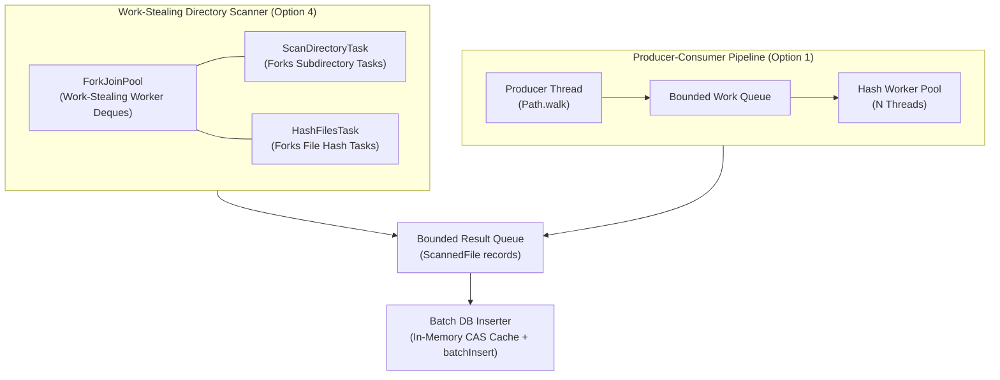
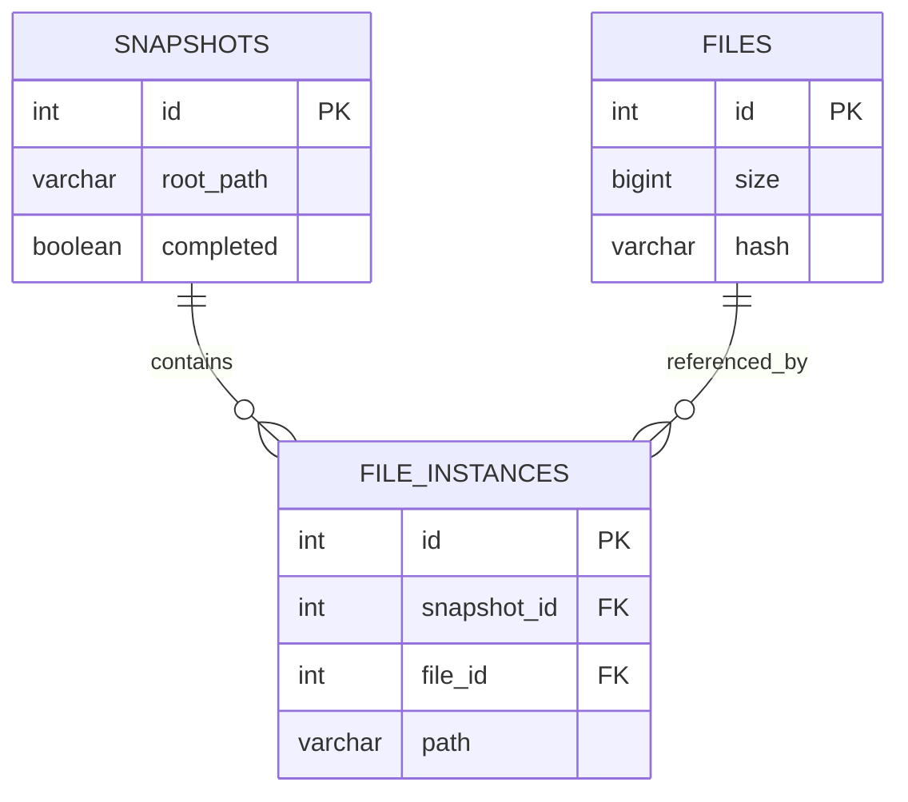

# Boveda

A vault of documents, images, and other files. Boveda scans directory hierarchies, computes cryptographic fingerprints, records file snapshots into an SQL database using [JetBrains Exposed](https://github.com/JetBrains/Exposed), and runs analytical queries such as content-based duplicate detection.

---

## Features

- **Decoupled CLI Commands (`scan` and `db`)**: Clean separation between directory scanning / database population (`scan`) and offline analytical database querying (`db`, `db print-duplicates`).
- **Resume Incomplete Scans (`scan --continue <snapshot_id>`)**: If a scan is interrupted or terminated midway, resume exactly where it left off using the snapshot ID. The directory path is retrieved directly from the snapshot, and files already processed with matching path, name, timestamp, and size are skipped without recomputing cryptographic hashes.
- **Work-Stealing Parallel Directory Scanner**: Concurrently explores directory branches across a `ForkJoinPool`, dynamically balancing subdirectory traversal and file hashing tasks via thread-local deques to maximize throughput on NVMe SSDs and multi-core CPUs.
- **Multi-Threaded Producer-Consumer Pipeline**: Decouples directory walking (Stage 1), cryptographic hashing across worker thread pools (Stage 2), and database persistence (Stage 3) via bounded queues for maximum multi-core CPU utilization.
- **Recursive Directory Scanner**: Traverses directory trees, filtering for regular files while recording relative paths, file sizes, and timestamps.
- **Streaming File Hashing & Prefix-Only Option (`--max-hash-bytes`)**: Fast, chunk-based hashing (XXH3 default, MD5, SHA-256, SHA-512, etc.) that handles large files efficiently. Supports optional prefix hashing (`64Kb`, `128Kb`, `256Kb`, `512Kb`, `1Mb`, or full size) combined with file size for lightning-fast comparison of multi-gigabyte files.
- **Content-Addressable Storage & In-Memory Deduplication Cache**: File content records (`RepoFiles`) are deduplicated by size and content hash, with separate instance records (`RepoFileInstances`) linking snapshots to files. An in-memory cache pre-warms known hashes and eliminates individual database lookups during ingestion.
- **High-Throughput Batch Ingestion**: Buffers scanned files into configurable batch sizes (default 1,000 files/transaction) and issues optimized SQL `batchInsert` operations, dramatically increasing scanning throughput.
- **SQL Analytics & Duplicate Detection**: Uses SQL window functions (`ROW_NUMBER() OVER(PARTITION BY hash ORDER BY path)`) to index and find identical files across snapshots.
- **Snapshot Management (`db snapshots list`, `db snapshots delete`)**: Inspect all recorded snapshots in a formatted table showing snapshot ID, root path, file counts, total storage size, and completion status. Delete unneeded snapshots by ID with automatic cascade deletion of file instances and orphaned file metadata.
- **Duplication & Storage Statistics with Mordant Table**: With `boveda db print-duplicates`, outputs a comprehensive statistical report including total files scanned/ingested, wasted duplicate storage, top 10 duplicate groups ordered by combined duplicate space, and a Mordant-rendered 10% percentile deciles table featuring total file size (`Size`) per decile and summed totals in the footer row.
- **Mordant Progress Indicator**: During quiet scans (`--quiet`), displays a live animated Mordant progress bar showing processed file counts and real-time average ingestion speeds (files/second and megabytes/second).
- **Rich CLI with Clikt**: Structured command-line interface with subcommands, path validation, custom hashing algorithm selection, quiet mode, persistent database options, and snapshot targeting.
- **GraalVM Native Image Ready**: Configured with GraalVM Native Build Tools to compile into a fast, standalone native binary without JVM startup overhead.
- **Flexible Storage**: Supports both in-memory H2 databases for transient runs and persistent file-backed databases (`.mv.db`) for long-term tracking.

---

## Prerequisites

- **Java Development Kit (JDK)**: Java 22 (or toolchain provisioned via Gradle)
- **Gradle**: Wrapper included (`./gradlew`)

---

## Installation & Build

Build the project and run the test suite:

```bash
# Build the project
./gradlew build

# Run unit and integration tests
./gradlew test

# Run verification and Kover code coverage checks
./gradlew check

# Build standalone GraalVM Native Image executable
./gradlew nativeCompile

# Run the compiled native binary directly
./build/native/nativeCompile/boveda --help

# Or compile and run directly with Gradle
./gradlew nativeRun --args="--help"
```

---

## CLI Structure & Usage

Boveda provides two main subcommands: **`scan`** and **`db`** (with nested **`print-duplicates`**).

```text
Usage: boveda [<options>] <command> [<args>]...

  Boveda: File vault fingerprinting, deduplication scanner, and analytical
  database querying.

Options:
  -l, --log-level=(OFF|ERROR|WARN|WARNING|INFO|DEBUG|TRACE)
              Logging level (OFF, ERROR, WARN, INFO, DEBUG, TRACE). Default is WARN.
  -h, --help  Show this message and exit

Commands:
  scan  Scan directory and populate the target database with file fingerprints.
  db    Query an already existing/computed database.
```

### 1. `scan` Subcommand

Scans a directory tree, computes file content hashes, and populates the target database with a new snapshot:

```text
Usage: boveda scan [<options>] [<directory>] [<database>]

  Scan directory and populate the target database with file fingerprints.

Options:
  -c, --continue=<int>    Resume an incomplete directory scan for the given snapshot ID.
  -d, --db=<path>         Target database file path.
  -a, --algorithm=<text>  File hashing algorithm (e.g. XXH3, CRC32, MD5, SHA-256, SHA-512). Default is XXH3.
  -m, --max-hash-bytes=<size>
                          Maximum initial bytes to hash per file as well as file size (e.g. 64Kb, 128Kb, 256Kb, 512Kb, 1Mb, full). Default is full file.
  -q, --quiet             Suppress per-file progress output during directory scan.
  -b, --batch-size=<int>  Number of files to batch per database transaction during scanning. Default is 1000.
  -t, --threads=<int>     Number of worker threads for parallel file hashing (defaults to available CPU cores).
  -s, --scanner=(work-stealing|parallel|sequential)
                          Directory scanner strategy: 'work-stealing' (default), 'parallel', or 'sequential'.
  --work-stealing         Enable work-stealing parallel directory traversal using ForkJoinPool.
  --no-cache-warmup       Disable pre-warming the in-memory deduplication cache from the database on startup.
  -l, --log-level=(OFF|ERROR|WARN|WARNING|INFO|DEBUG|TRACE)
                          Logging level (OFF, ERROR, WARN, INFO, DEBUG, TRACE).
  -h, --help              Show this message and exit

Arguments:
  <directory>  Directory path to scan (optional when --continue is provided).
  <database>   Target database file path.
```

#### Best Scan Options & Hashing Strategy Guide

For the full empirical benchmark report across large files (100 MB – 1 GB) and prefix limits, see [hashing_benchmark_report.md](hashing_benchmark_report.md).

| Requirement / Circumstance | Recommended Scan Options | Rationale |
| :--- | :--- | :--- |
| **General Deduplication (Default)** | `boveda scan <dir> <db>` *(defaults to `--algorithm XXH3`)* | **2.7–3.0 GB/s** hashing rate on NVMe; 64-bit entropy protects against accidental collisions. Safe for deduplication reports. |
| **Terabyte-Scale Storage / Large Media & ISOs** | `boveda scan --max-hash-bytes 1Mb <dir> <db>` | **~500x speedup** on large files (1 GB hashed in **0.69 ms**). Combines the first 1 MB prefix with the exact file size to eliminate disk read bottlenecks. |
| **Safe Deletion Workflows (`db file delete`)** | `boveda scan --algorithm XXH3 <dir> <db>` *(Full hashing, omit `--max-hash-bytes`)* | Full content hashing ensures distinct files sharing identical headers or sizes are never falsely matched. **Never use CRC32 for deletion.** |
| **Cloud / Amazon S3 / Legacy Manifests** | `boveda scan --algorithm MD5 <dir> <db>` | Generates 128-bit MD5 hex digests matching Amazon S3 ETags, `rsync --checksum`, and `md5sum` registries. |
| **Low-Power / Battery-Constrained Devices** | `boveda scan --max-hash-bytes 64Kb <dir> <db>` *(or `--algorithm CRC32`)* | Minimizes storage I/O and CPU compute cycles, preserving battery and preventing thermal throttling on NAS/Raspberry Pi. |

> [!WARNING]
> **Why CRC32 must NEVER be used for deletion workflows:**
> `CRC32` produces only a 32-bit checksum. Under the Birthday paradox, there is a **50% probability of an accidental hash collision at just ~77,000 files**. In a repository with 100k+ files, CRC32 will falsely flag distinct files as duplicates. If `db file delete` is executed on a CRC32 database, distinct user files could be permanently deleted! Always use `XXH3` (or `SHA-256`/`MD5`) for deduplication and deletion workflows.

### 2. `db` Subcommand

Queries an existing/computed database without scanning the filesystem. If invoked without a nested subcommand, it prints all recorded file records from the latest snapshot:

```text
Usage: boveda db [<options>] [<database>] <command> [<args>]...

  Query an already existing/computed database.

Options:
  -d, --db=<path>       Path to persistent H2 database file.
  -s, --snapshot=<int>  Optional snapshot ID to query. Defaults to the latest snapshot.
  -l, --log-level=(OFF|ERROR|WARN|WARNING|INFO|DEBUG|TRACE)
                        Logging level (OFF, ERROR, WARN, INFO, DEBUG, TRACE).
  -h, --help            Show this message and exit

Arguments:
  <database>  Path to persistent H2 database file.

Commands:
  file              Manage files in the database (delete duplicates).
  print-duplicates  Query the provided database for the latest snapshot and print duplicate files and statistics.
  snapshots         Manage database snapshots (list, delete).
```

### 3. `db print-duplicates` Subcommand

Queries the database for duplicate files (files sharing identical content hashes within a snapshot) and prints duplication overview metrics, the top 10 duplicate groups ordered by combined duplicate space, and a Mordant percentile decile table:

```text
Usage: boveda db print-duplicates [<options>] [<database>]
# or: boveda db [<database>] print-duplicates [<options>]

  Query the provided database for the latest snapshot and print duplicate files and statistics.

Options:
  -v, --verbose         Print every duplicate file entry found in the database.
  -d, --db=<path>       Path to persistent H2 database file.
  -s, --snapshot=<int>  Optional snapshot ID to query. Defaults to the latest snapshot.
  -l, --log-level=(OFF|ERROR|WARN|WARNING|INFO|DEBUG|TRACE)
                        Logging level (OFF, ERROR, WARN, INFO, DEBUG, TRACE).
  -h, --help            Show this message and exit

Arguments:
  <database>  Path to persistent H2 database file.
```

### 4. `db snapshots list` Subcommand

Lists all recorded snapshots in the database in a formatted table showing snapshot ID, root path, file count, total storage size, and completion status:

```text
Usage: boveda db snapshots list [<options>] [<database>]
# or: boveda db [<database>] snapshots list [<options>]

  List all snapshots stored in the database.

Options:
  -d, --db=<path>  Path to persistent H2 database file.
  -l, --log-level=(OFF|ERROR|WARN|WARNING|INFO|DEBUG|TRACE)
                   Logging level (OFF, ERROR, WARN, INFO, DEBUG, TRACE).
  -h, --help       Show this message and exit

Arguments:
  <database>  Path to persistent H2 database file.
```

### 5. `db snapshots delete` Subcommand

Deletes a chosen snapshot by its snapshot ID from the database, cascading to remove its file instances and any orphaned files no longer referenced by other snapshots:

```text
Usage: boveda db snapshots delete [<options>] <snapshot_id> [<database>]
# or: boveda db [<database>] snapshots delete <snapshot_id> [<options>]

  Delete a snapshot from the database by its snapshot ID.

Options:
  -d, --db=<path>  Path to persistent H2 database file.
  -l, --log-level=(OFF|ERROR|WARN|WARNING|INFO|DEBUG|TRACE)
                   Logging level (OFF, ERROR, WARN, INFO, DEBUG, TRACE).
  -h, --help       Show this message and exit

Arguments:
  <snapshot_id>  ID of the snapshot to delete.
  <database>     Path to persistent H2 database file.
```

### 6. `db file delete` Subcommand

Deletes duplicate files from both disk and the database snapshot, automatically cleaning up orphaned CAS records when all references to a file's content are removed:

* **Single-File Mode**: If a file path is specified, deletes it from disk and database, but only if duplicate copies exist (or if `--force` is specified).
* **Interactive Mode**: If no file path is specified, finds the duplicate group wasting the most storage and provides an interactive terminal multi-select prompt (<kbd>↑</kbd>/<kbd>↓</kbd> navigate, <kbd>Space</kbd>/<kbd>x</kbd> toggle, <kbd>a</kbd> toggle all, <kbd>Enter</kbd> delete selected, <kbd>Esc</kbd> quit), looping to find the next largest group until resolved or exited.

```text
Usage: boveda db file delete [<options>] [<file>] [<database>]
# or: boveda db [<database>] file delete [<file>] [<options>]

  Delete duplicate files from disk and the database snapshot.

Options:
  -f, --file=<path>     Path of the file to delete from disk and database.
  -d, --db=<path>       Path to persistent H2 database file.
  --force               Force deletion of file even if it has no duplicates.
  -s, --snapshot=<int>  Optional snapshot ID to query. Defaults to the latest snapshot.
  -l, --log-level=(OFF|ERROR|WARN|WARNING|INFO|DEBUG|TRACE)
                        Logging level (OFF, ERROR, WARN, INFO, DEBUG, TRACE).
  -h, --help            Show this message and exit

Arguments:
  <file>      Optional path of the file to delete. If omitted, starts interactive duplicate selector.
  <database>  Path to persistent H2 database file.
```

---

## Examples

### 1. Scan a Directory and Populate a Database
Scan `/path/to/my/documents` and record all file fingerprints into `/tmp/vault.db`:
```bash
./gradlew run --args="scan /path/to/my/documents /tmp/vault.db"
```
*(Creates the H2 database file at `/tmp/vault.db.mv.db`.)*

### 2. Quiet Scan with Live Progress Indicator
Suppress per-file terminal output and show an animated Mordant progress bar showing files processed and real-time ingestion speeds:
```bash
./gradlew run --args="scan --quiet /path/to/my/documents /tmp/vault.db"
```
During scanning:
```text
⠋ Scanning & ingesting: 1,420 files (115.4 files/s, 24.50 MB/s) 0:00:12
```
On completion:
```text
✔ Scanned 1,420 files (450.20 MB) in 12.30s (115.4 files/s, 24.50 MB/s)
```

### 3. Query All Files in an Existing Database
Query the latest snapshot in `/tmp/vault.db` without re-scanning the filesystem:
```bash
./gradlew run --args="db /tmp/vault.db"
```

### 4. Query Duplicate Files & Duplication Statistics Report
Analyze the latest snapshot in `/tmp/vault.db` for duplicate files and storage waste:
```bash
# Default: prints top 10 duplicate groups and summary deciles table
./gradlew run --args="db print-duplicates /tmp/vault.db"
# or equivalently:
./gradlew run --args="db /tmp/vault.db print-duplicates"

# Verbose: also print every individual duplicate file entry in the database
./gradlew run --args="db print-duplicates --verbose /tmp/vault.db"
```

Example report output:
```text
================================================================================
                           DUPLICATION SUMMARY
================================================================================
Scan & Ingestion Statistics:
  Total Files Scanned:       4,142 files
  Total Storage Scanned:     130.56 MB
  Unique File Contents:      2,306 files
  Unique Storage:            41.50 MB
  Total Processing Time:     145ms

Duplication Overview:
  Duplicate Content Groups:  412 unique files duplicated
  Duplicate File Instances:  2,248 files (1,836 redundant copies)
  Total Duplicated Storage:  130.56 MB
  Wasted Storage:            89.06 MB
  Wasted Storage Share:      68.21% of total scanned storage

--------------------------------------------------------------------------------
Top 10 Largest Duplicate Files:
--------------------------------------------------------------------------------
 1. 25.40 MB | 2 copies | Combined: 50.80 MB | Wasted: 25.40 MB
    Hash: 4f1a...
    Paths:
      - /data/backup/video1.mp4
      - /data/media/video1.mp4
 2. 12.10 MB | 3 copies | Combined: 36.30 MB | Wasted: 24.20 MB
    Hash: a82c...
    Paths:
      - /data/docs/archive.tar
      - /data/old/archive.tar
      - /data/tmp/archive.tar
 ...

--------------------------------------------------------------------------------
Percentile Buckets by File Size (10% Deciles):
--------------------------------------------------------------------------------
┌────────────┬─────────────────────┬───────┬─────────┬────────────────────┬────────────────┬───────────┐
│ Percentile │     Size Range      │ Files │  Size   │ Duplicated Storage │ Wasted Storage │ Share (%) │
╞════════════╪═════════════════════╪═══════╪═════════╪════════════════════╪════════════════╪═══════════╡
│ 0% - 10%   │ [147 B - 171 B]     │   640 │  8.0 KB │          103.13 KB │       95.17 KB │     0.10% │
│ 10% - 20%  │ [171 B - 171 B]     │ 1,836 │  8.3 KB │          306.60 KB │      298.25 KB │     0.33% │
│ 20% - 30%  │ [171 B - 171 B]     │   390 │  8.5 KB │           65.13 KB │       56.61 KB │     0.06% │
│ 30% - 40%  │ [171 B - 171 B]     │   128 │  8.3 KB │           21.38 KB │       13.03 KB │     0.01% │
│ 40% - 50%  │ [172 B - 10.07 KB]  │   308 │ 74.6 KB │          197.88 KB │      123.25 KB │     0.14% │
│ 50% - 60%  │ [10.09 KB - 18.5 KB]│   111 │748.4 KB │            1.65 MB │      921.56 KB │     1.01% │
│ 60% - 70%  │ [18.56 KB - 24.7 KB]│   105 │  1.1 MB │            2.26 MB │        1.18 MB │     1.33% │
│ 70% - 80%  │ [24.72 KB - 36.2 KB]│   102 │  1.5 MB │            2.91 MB │        1.45 MB │     1.63% │
│ 80% - 90%  │ [36.46 KB - 51.8 KB]│   572 │  2.1 MB │           24.43 MB │       22.30 MB │    25.04% │
│ 90% - 100% │ [52.08 KB - 14.1 MB]│   264 │ 37.7 MB │          100.38 MB │       62.65 MB │    70.35% │
╞════════════╪═════════════════════╪═══════╪═════════╪════════════════════╪════════════════╪═══════════╡
│ Total      │ [147 B - 14.11 MB]  │ 4,142 │ 41.5 MB │          130.56 MB │       89.06 MB │   100.00% │
└────────────┴─────────────────────┴───────┴─────────┴────────────────────┴────────────────┴───────────┘
--------------------------------------------------------------------------------
Total Wasted Storage: 89.06 MB (93,382,389 bytes)
================================================================================
```

### 5. Hashing Algorithms (XXH3, CRC32, MD5, SHA-256)
Specify a non-cryptographic or cryptographic hashing algorithm:
```bash
# High-performance default non-cryptographic hash (2.7–3.0 GB/s on NVMe)
./gradlew run --args="scan --algorithm XXH3 /path/to/my/documents /tmp/vault.db"

# Amazon S3 ETag compatible MD5 digest (630 MB/s)
./gradlew run --args="scan --algorithm MD5 /path/to/my/documents /tmp/vault.db"

# Hardware-accelerated CRC32 for low-power devices (4.0 GB/s)
./gradlew run --args="scan --algorithm CRC32 /path/to/my/documents /tmp/vault.db"

# Cryptographic SHA-256
./gradlew run --args="scan --algorithm SHA-256 /path/to/my/documents /tmp/vault.db"
```

### 6. Fast Prefix Hashing on Large Files (`--max-hash-bytes`)
Accelerate scanning of large media, video libraries, and archives by hashing only an initial prefix combined with the exact file size (up to 500x speedup):
```bash
# Hash only the first 1 MB per file (combines 1 MB prefix + total file size)
./gradlew run --args="scan --max-hash-bytes 1Mb /path/to/my/videos /tmp/vault.db"

# Ultra-fast 64 KB prefix scan for network shares (NAS)
./gradlew run --args="scan --max-hash-bytes 64Kb /mnt/nas/media /tmp/vault.db"
```

### 7. Multi-Threaded Parallel & Work-Stealing Traversal
Configure worker thread pools and directory exploration strategy:
```bash
# Work-stealing ForkJoinPool scanner with 8 threads (default)
./gradlew run --args="scan --threads 8 --work-stealing /path/to/my/documents /tmp/vault.db"

# Producer-consumer pipeline scanner
./gradlew run --args="scan --scanner parallel --threads 8 /path/to/my/documents /tmp/vault.db"

# Sequential scanner for rotational hard drives
./gradlew run --args="scan --scanner sequential /path/to/my/documents /tmp/vault.db"
```

### 8. High-Throughput Batch Ingestion & Cache Tuning
Tune database batch transaction sizes and cache warm-up:
```bash
# Ingest in batches of 2,000 files
./gradlew run --args="scan --batch-size 2000 /path/to/my/documents /tmp/vault.db"

# Disable cache pre-warming on memory-constrained systems
./gradlew run --args="scan --no-cache-warmup /path/to/my/documents /tmp/vault.db"
```

### 9. Query a Specific Snapshot by ID
Query a historical snapshot rather than the default latest snapshot:
```bash
./gradlew run --args="db --snapshot 2 /tmp/vault.db"
./gradlew run --args="db print-duplicates --snapshot 2 /tmp/vault.db"
```

### 10. Enable Debug SQL Query Logging
Direct SQL query execution logs to stderr by setting `--log-level=DEBUG`:
```bash
./gradlew run --args="-l DEBUG scan /path/to/my/documents /tmp/vault.db"
```

### 11. List Existing Database Snapshots
List all recorded snapshots with root directory path, total file counts, storage size, and completion status:
```bash
./gradlew run --args="db snapshots list /tmp/vault.db"
# or equivalently:
./gradlew run --args="db /tmp/vault.db snapshots list"
```

Example output:
```text
┌────┬──────────────┬─────────┬────────────┬───────────┐
│ ID │ Root Path    │   Files │ Total Size │  Status   │
╞════╪══════════════╪═════════╪════════════╪═══════════╡
│  1 │ /data/vault1 │   4,142 │  130.56 MB │ Completed │
│  2 │ /data/vault2 │     512 │   15.20 MB │ Completed │
└────┴──────────────┴─────────┴────────────┴───────────┘
```

### 12. Delete a Snapshot by Snapshot ID
Delete a specific snapshot by its ID, cleaning up its file instances and any orphaned files:
```bash
./gradlew run --args="db snapshots delete 1 /tmp/vault.db"
# or equivalently:
./gradlew run --args="db /tmp/vault.db snapshots delete 1"
```

Example output:
```text
Snapshot 1 deleted successfully.
```

### 13. Delete Duplicate Files from Disk and Database (`db file delete`)
Delete a specific duplicate file or use the interactive terminal prompt to reclaim space from the largest duplicate groups:
```bash
# Delete a specific duplicate file (fails if it has no duplicates, unless --force is given)
./gradlew run --args="db file delete /data/backup/video1.mp4 /tmp/vault.db"

# Force deletion of any file regardless of duplicate status
./gradlew run --args="db file delete --force /data/backup/old.log /tmp/vault.db"

# Interactive deletion: prompts to select and delete duplicates from the group wasting the most space
./gradlew run --args="db file delete /tmp/vault.db"
```

---

## Architecture Pipeline

Boveda supports both work-stealing tree traversal and producer-consumer pipelining:



1. **Work-Stealing Scanner ([WorkStealingDirectoryScanner](src/main/kotlin/com/cherba29/boveda/scanner/WorkStealingDirectoryScanner.kt))**: Recursively splits directory exploration and file hashing into fine-grained tasks in a `ForkJoinPool`. Idle threads steal directory branches or file chunks, maximizing throughput on deep hierarchies and fast NVMe storage.
2. **Producer-Consumer Pipeline ([ParallelDirectoryScanner](src/main/kotlin/com/cherba29/boveda/scanner/ParallelDirectoryScanner.kt))**: Emits files from a single discovery thread into a bounded queue drained by a dedicated worker pool.
3. **Batch Persistence ([BovedaService](src/main/kotlin/com/cherba29/boveda/service/BovedaService.kt))**: Drains records, resolves duplicates against the in-memory cache, and batch inserts records in single transactions.

---

## Database Schema

Boveda uses Exposed to manage an H2 relational schema:



- **`snapshots`**: Records each scan run with root path and completion status.
- **`files`**: Stores distinct file payloads identified by `(size, hash)`. Identical files across paths share a single `files` entry.
- **`file_instances`**: Links a snapshot and a file path to its corresponding content record in `files`.

---

## Project Structure

```text
src/main/
├── resources/
│   ├── logback.xml                         # Logback configuration directing WARN/ERROR logs to stderr
│   └── META-INF/native-image/
│       ├── reflect-config.json             # GraalVM reflection metadata for Exposed DAO & column types
│       └── proxy-config.json               # Dynamic proxy configuration for Native Image
└── kotlin/com/cherba29/boveda/
    ├── Main.kt                             # Clikt CLI commands (BovedaCommand, ScanCommand, DbCommand, PrintDuplicatesCommand)
    ├── cache/
    │   └── DeduplicationCache.kt           # In-memory deduplication cache & hit/miss metrics
    ├── hash/
    │   └── FileHasher.kt                   # Streamed cryptographic hashing (FileHasher, MessageDigestFileHasher)
    ├── logging/
    │   └── LoggingConfig.kt                # Logback runtime level configuration
    ├── scanner/
    │   ├── DiscoveredFile.kt               # Intermediate discovered file metadata
    │   ├── ScannedFile.kt                  # File metadata DTO (path, size, hash, lastModified)
    │   ├── DirectoryScanner.kt             # Scanner interface & FileTreeDirectoryScanner
    │   ├── ParallelDirectoryScanner.kt     # Multi-threaded producer-consumer scanner
    │   └── WorkStealingDirectoryScanner.kt # Work-stealing ForkJoinPool scanner
    ├── progress/
    │   └── ScanProgressIndicator.kt        # Mordant progress indicator & ingestion speed metrics
    ├── model/
    │   ├── FileRecords.kt                  # Database query DTOs (FileRecord, FileRecordWithDuplicateRank)
    │   └── DuplicateStatistics.kt          # Duplicate statistics, percentile deciles, and formatters
    ├── db/
    │   ├── Tables.kt                       # Exposed table definitions (RepoSnapshots, RepoFiles, RepoFileInstances)
    │   ├── Entities.kt                     # Exposed DAO entities (RepoSnapshot, RepoFile, RepoFileInstance)
    │   └── DatabaseFactory.kt              # H2 connection helpers & schema initializers
    └── service/
        └── BovedaService.kt                # Coordination service for scanning, persistence, and queries
```

---

## Roadmap

- [ ] Remote storage connectors (Google Drive, Google Photos)
- [ ] Archive exploration (ZIP / TAR inspection without extracting)
- [ ] OCR indexing for PDF and scanned image documents
- [ ] Image date & EXIF metadata extraction
- [ ] Classification and sorting using AI models
