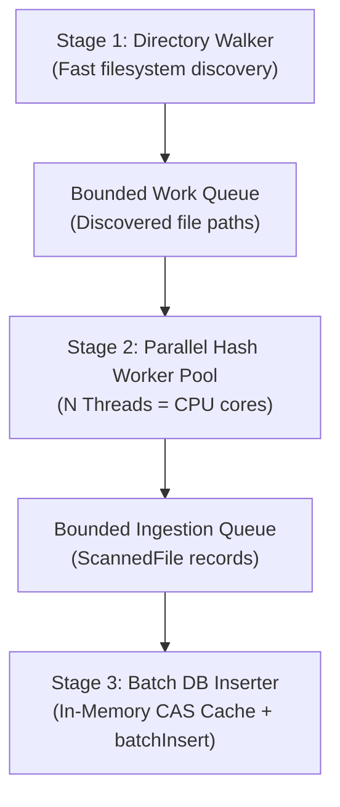
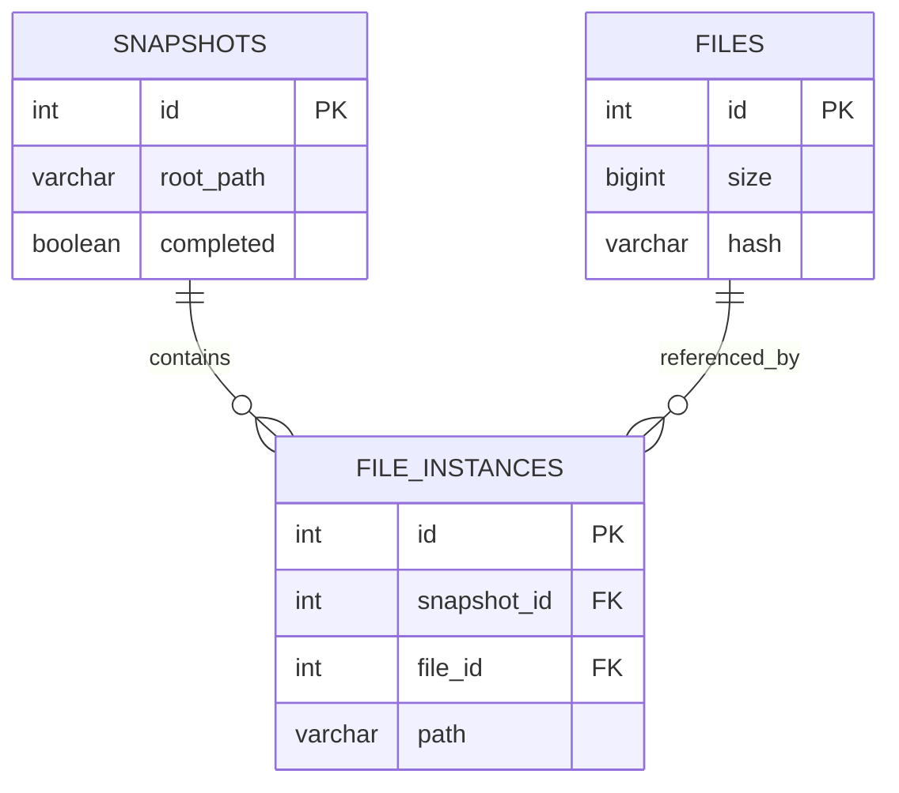

# Boveda

A vault of documents, images, and other files. Boveda scans directory hierarchies, computes cryptographic fingerprints, records file snapshots into an SQL database using [JetBrains Exposed](https://github.com/JetBrains/Exposed), and runs analytical queries such as content-based duplicate detection.

---

## Features

- **Recursive Directory Scanner**: Traverses directory trees, filtering for regular files while recording relative paths, file sizes, and timestamps.
- **Multi-Threaded Producer-Consumer Pipeline**: Decouples directory walking (Stage 1), cryptographic hashing across worker thread pools (Stage 2), and database persistence (Stage 3) via bounded queues for maximum multi-core CPU utilization.
- **Streaming Cryptographic Hashing**: Chunk-based hashing (MD5, SHA-256, SHA-512, etc.) that handles large files efficiently without loading them entirely into memory.
- **Content-Addressable Storage & In-Memory Deduplication Cache**: File content records (`RepoFiles`) are deduplicated by size and content hash, with separate instance records (`RepoFileInstances`) linking snapshots to files. An in-memory cache pre-warms known hashes and eliminates individual database lookups during ingestion.
- **High-Throughput Batch Ingestion**: Buffers scanned files into configurable batch sizes (default 1,000 files/transaction) and issues optimized SQL `batchInsert` operations, dramatically increasing scanning throughput.
- **SQL Analytics & Duplicate Detection**: Uses SQL window functions (`ROW_NUMBER() OVER(PARTITION BY hash ORDER BY path)`) to index and find identical files across the directory tree.
- **Duplication & Storage Statistics**: When running with `--duplicates-only`, outputs a comprehensive statistical report including total files scanned/ingested, wasted duplicate storage, top 10 largest duplicate groups, 10% percentile decile buckets of file size distribution, and total elapsed processing time.
- **Mordant Progress Indicator**: During quiet scans (`--quiet`), displays a live animated Mordant progress bar showing processed file counts and real-time average ingestion speeds (files/second and megabytes/second).
- **Rich CLI with Clikt**: Structured command-line argument parsing with path validation, custom hashing algorithm selection, quiet mode, persistent database options, and duplicate filtering.
- **GraalVM Native Image Ready**: Configured with GraalVM Native Build Tools to compile into a fast, standalone native binary without JVM startup overhead.
- **Flexible Storage**: Supports both in-memory H2 databases for transient runs and persistent file-backed databases for long-term tracking.

---

## Prerequisites

- **Java Development Kit (JDK)**: Java 22 (or toolchain provisioned via Gradle)
- **Gradle**: Wrapper included (`./gradlew`)

---

## Installation & Build

Build the project and run the test suite:

```bash
# Build the project
./gradlew build

# Run unit and integration tests
./gradlew test

# Run verification and Kover code coverage checks
./gradlew check

# Build standalone GraalVM Native Image executable
./gradlew nativeCompile

# Run the compiled native binary directly
./build/native/nativeCompile/boveda --help

# Or compile and run directly with Gradle
./gradlew nativeRun --args="--help"
```

---

## CLI Usage

Run Boveda using `./gradlew run`:

```text
Usage: boveda [<options>] [<directory>]

  Scan directories, record file fingerprints in database, and query results.

Options:
  -a, --algorithm=<text>  Cryptographic hashing algorithm (e.g. MD5, SHA-256,
                          SHA-512). Default is MD5.
  -d, --db=<path>         Optional file path for persistent H2 database.
                          Defaults to an in-memory database.
  -l, --log-level=(OFF|ERROR|WARN|WARNING|INFO|DEBUG|TRACE)
                          Logging level (OFF, ERROR, WARN, INFO, DEBUG, TRACE).
                          Default is WARN.
  -q, --quiet             Suppress per-file progress output during directory
                          scan.
  --duplicates-only       Only query and print files that have duplicate
                          contents.
  -b, --batch-size=<int>  Number of files to batch per database transaction
                          during scanning. Default is 1000.
  -t, --threads=<int>     Number of worker threads for parallel file hashing
                          (defaults to available CPU cores).
  --no-cache-warmup       Disable pre-warming the in-memory deduplication cache
                          from the database on startup.
  -h, --help              Show this message and exit

Arguments:
  <directory>  Directory path to scan (defaults to current directory '.')
```

---

## Examples

### 1. Scan Current Directory
Scans the current working directory, computes MD5 hashes, stores metadata in an in-memory database, and prints all query results:
```bash
./gradlew run
```

### 2. Scan a Specific Directory
Pass the path to any target directory:
```bash
./gradlew run --args="/path/to/my/documents"
```

### 3. Display Help and Available Options
```bash
./gradlew run --args="--help"
```

### 4. Use SHA-256 Hashing Algorithm
Specify a different cryptographic algorithm (e.g., `SHA-256` or `SHA-512`):
```bash
./gradlew run --args="--algorithm SHA-256 /path/to/my/documents"
```

### 5. Find Duplicate Files & View Storage Statistics Summary
Filter the database query to only display files that share identical content hashes with at least one other file. At the end of the run, a detailed summary report is displayed:
```bash
./gradlew run --args="--duplicates-only /path/to/my/documents"
```

Example summary report output:
```text
================================================================================
DUPLICATION STATISTICS SUMMARY
================================================================================
Files Scanned / Ingested: 1,420 (450.20 MB)
Unique File Contents:     1,280 (380.10 MB)
Duplicate Groups:         95 (140 files)
Duplicated Storage:       112.50 MB across all copies
Wasted Storage:           70.10 MB recoverable by removing copies
Total Processing Time:    1.24s (1,240 ms)

--------------------------------------------------------------------------------
Top 10 Largest Duplicate Groups
--------------------------------------------------------------------------------
 1. 25.40 MB / file (2 copies, 25.40 MB wasted) [hash: 4f1a...]
    - ./backup/video1.mp4
    - ./media/video1.mp4
 2. 12.10 MB / file (3 copies, 24.20 MB wasted) [hash: a82c...]
    - ./docs/archive.tar
    - ./old/archive.tar
    - ./tmp/archive.tar
 ...

--------------------------------------------------------------------------------
Duplicate Storage Distribution by File Size Deciles (10% Percentile Buckets)
--------------------------------------------------------------------------------
Percentile Range     Size Range                  Files    Duplicated        Wasted  % Wasted
--------------------------------------------------------------------------------
P00 - P10            12 B - 240 B                   14       2.40 KB       1.20 KB      0.0%
P10 - P20            240 B - 1.50 KB                14      18.20 KB       9.10 KB      0.0%
P20 - P30            1.50 KB - 12.00 KB             14     120.40 KB      60.20 KB      0.1%
P30 - P40            12.00 KB - 85.00 KB            14     850.00 KB     425.00 KB      0.6%
P40 - P50            85.00 KB - 450.00 KB           14       4.20 MB       2.10 MB      3.0%
P50 - P60            450.00 KB - 1.80 MB            14      16.50 MB       8.25 MB     11.8%
P60 - P70            1.80 MB - 5.40 MB              14      38.00 MB      19.00 MB     27.1%
P70 - P80            5.40 MB - 12.10 MB             14      65.20 MB      32.60 MB     46.5%
P80 - P90            12.10 MB - 25.40 MB            14      92.00 MB      46.00 MB     65.6%
P90 - P100           25.40 MB - 25.40 MB            14     112.50 MB      56.25 MB     80.2%
================================================================================
```

### 6. Quiet Mode with Mordant Progress Indicator
Suppress per-file logging during scan and display an animated Mordant progress indicator with processed file counts and average ingestion speeds (files/second and MB/second):
```bash
./gradlew run --args="--quiet /path/to/my/documents"
```
During scanning, a live progress indicator is displayed:
```text
⠋ Scanning & ingesting: 1,420 files (115.4 files/s, 24.50 MB/s) 0:00:12
```
Upon completion, the final ingestion summary is printed:
```text
✔ Scanned 1,420 files (450.20 MB) in 12.30s (115.4 files/s, 24.50 MB/s)
```

### 7. Persist to a Database File
Save the snapshot and fingerprints to a persistent H2 database on disk instead of an in-memory database:
```bash
./gradlew run --args="--db /tmp/my_boveda_vault /path/to/my/documents"
```
*(This creates an H2 database file at `/tmp/my_boveda_vault.mv.db`.)*

### 8. Enable Debug SQL Logging
By default, Exposed database queries are suppressed (log level is `WARN`, routed to stderr). To view all executed SQL queries in `stderr`, pass `--log-level=DEBUG`:
```bash
./gradlew run --args="--log-level=DEBUG /path/to/my/documents"
```

### 9. High-Throughput Batch Ingestion & Cache Tuning
Configure batch size (number of file instances per database transaction) and cache behavior for scanning massive vaults:
```bash
./gradlew run --args="--batch-size 2000 --db /tmp/my_vault /path/to/my/documents"
```
On startup, Boveda automatically pre-warms its in-memory deduplication cache from the database so that previously scanned files are resolved with zero SQL queries. To disable pre-warming on memory-constrained systems, use `--no-cache-warmup`:
```bash
./gradlew run --args="--no-cache-warmup --db /tmp/my_vault /path/to/my/documents"
```

### 10. Multi-Threaded Parallel Hashing
Accelerate scanning across multi-core CPUs by allocating a dedicated worker thread pool (defaults to all available CPU cores):
```bash
./gradlew run --args="--threads 8 /path/to/my/documents"
```

### 11. Combined Options
Scan quietly using SHA-256 with 8 worker threads, debug logging to stderr, custom batch size of 2,000, only showing duplicates:
```bash
./gradlew run --args="-q -a SHA-256 -t 8 -b 2000 -l DEBUG --duplicates-only /path/to/my/photos"
```

---

## Architecture Pipeline

Boveda employs a 3-stage asynchronous producer-consumer pipeline:



1. **Stage 1 (Discovery)**: The producer walks the directory tree rapidly without hashing, placing file metadata into a bounded work queue.
2. **Stage 2 (Parallel Hashing)**: A configurable pool of worker threads concurrently hashes file streams using chunked memory-efficient buffers.
3. **Stage 3 (Batch Persistence)**: The database consumer drains batches of file records, resolves duplicate content fingerprints via the in-memory cache, and batch inserts records in single transactions.

---

## Database Schema

Boveda uses Exposed to manage an H2 relational schema:



- **`snapshots`**: Records each scan run with root path and completion status.
- **`files`**: Stores distinct file payloads identified by `(size, hash)`. Identical files across paths share a single `files` entry.
- **`file_instances`**: Links a snapshot and a file path to its corresponding content record in `files`.

---

## Project Structure

```text
src/main/
├── resources/
│   └── logback.xml             # Logback configuration directing WARN/ERROR logs to stderr
└── kotlin/com/cherba29/boveda/
    ├── Main.kt                 # Clikt CLI command & application entry point
    ├── cache/
    │   └── DeduplicationCache.kt # In-memory deduplication cache & metrics
    ├── hash/
    │   └── FileHasher.kt       # Streamed cryptographic hashing (FileHasher, MessageDigestFileHasher)
    ├── logging/
    │   └── LoggingConfig.kt    # Logback runtime level configuration
    ├── scanner/
    │   ├── ScannedFile.kt              # Discovered file metadata model
    │   ├── DirectoryScanner.kt         # Scanner interface & FileTreeDirectoryScanner
    │   └── ParallelDirectoryScanner.kt # Multi-threaded producer-consumer scanner
    ├── progress/
    │   └── ScanProgressIndicator.kt    # Mordant progress indicator & ingestion speed metrics
    ├── model/
    │   ├── FileRecords.kt          # Database query DTOs (FileRecord, FileRecordWithDuplicateRank)
    │   └── DuplicateStatistics.kt  # Duplicate statistics, percentile deciles, and formatters
    ├── db/
    │   ├── Tables.kt           # Exposed table definitions (RepoSnapshots, RepoFiles, RepoFileInstances)
    │   ├── Entities.kt         # Exposed DAO entities (RepoSnapshot, RepoFile, RepoFileInstance)
    │   └── DatabaseFactory.kt  # H2 connection helpers & schema initializers
    └── service/
        └── BovedaService.kt    # Coordination service for scanning, persistence, and queries
```

---

## Roadmap

- [ ] Remote storage connectors (Google Drive, Google Photos)
- [ ] Archive exploration (ZIP / TAR inspection without extracting)
- [ ] OCR indexing for PDF and scanned image documents
- [ ] Image date & EXIF metadata extraction
- [ ] Classification and sorting using AI models
