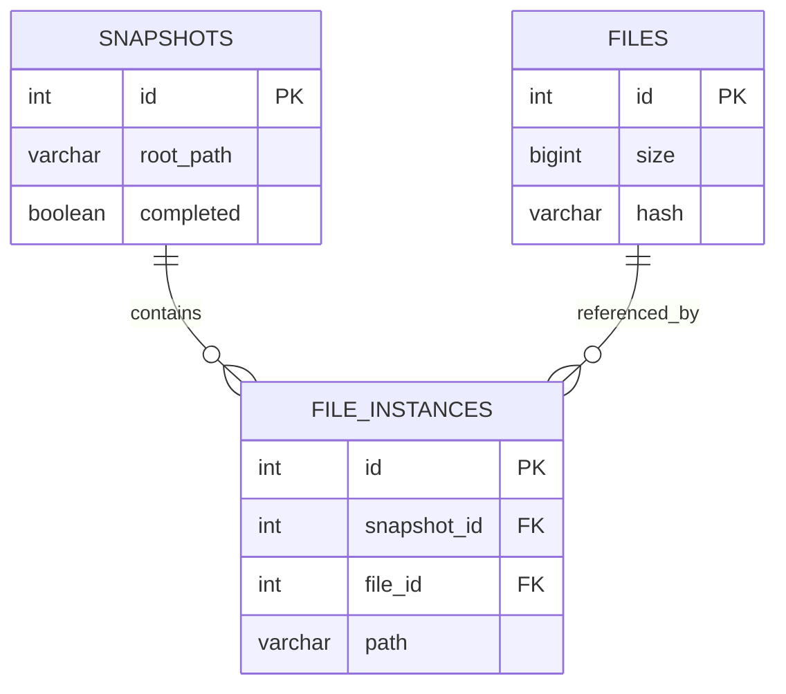

# Boveda

A vault of documents, images, and other files. Boveda scans directory hierarchies, computes cryptographic fingerprints, records file snapshots into an SQL database using [JetBrains Exposed](https://github.com/JetBrains/Exposed), and runs analytical queries such as content-based duplicate detection.

---

## Features

- **Recursive Directory Scanner**: Traverses directory trees, filtering for regular files while recording relative paths, file sizes, and timestamps.
- **Streaming Cryptographic Hashing**: Chunk-based hashing (MD5, SHA-256, SHA-512, etc.) that handles large files efficiently without loading them entirely into memory.
- **Content-Addressable Storage**: File content records (`RepoFiles`) are deduplicated by size and content hash, with separate instance records (`RepoFileInstances`) linking snapshots to files.
- **SQL Analytics & Duplicate Detection**: Uses SQL window functions (`ROW_NUMBER() OVER(PARTITION BY hash ORDER BY path)`) to index and find identical files across the directory tree.
- **Rich CLI with Clikt**: Structured command-line argument parsing with path validation, custom hashing algorithm selection, quiet mode, persistent database options, and duplicate filtering.
- **Flexible Storage**: Supports both in-memory H2 databases for transient runs and persistent file-backed databases for long-term tracking.

---

## Prerequisites

- **Java Development Kit (JDK)**: Java 22 (or toolchain provisioned via Gradle)
- **Gradle**: Wrapper included (`./gradlew`)

---

## Installation & Build

Build the project and run the test suite:

```bash
# Build the project
./gradlew build

# Run unit and integration tests
./gradlew test

# Run verification and Kover code coverage checks
./gradlew check
```

---

## CLI Usage

Run Boveda using `./gradlew run`:

```text
Usage: boveda [<options>] [<directory>]

  Scan directories, record file fingerprints in database, and query results.

Options:
  -a, --algorithm=<text>  Cryptographic hashing algorithm (e.g. MD5, SHA-256,
                          SHA-512). Default is MD5.
  -d, --db=<path>         Optional file path for persistent H2 database.
                          Defaults to an in-memory database.
  -q, --quiet             Suppress per-file progress output during directory
                          scan.
  --duplicates-only       Only query and print files that have duplicate
                          contents.
  -h, --help              Show this message and exit

Arguments:
  <directory>  Directory path to scan (defaults to current directory '.')
```

---

## Examples

### 1. Scan Current Directory
Scans the current working directory, computes MD5 hashes, stores metadata in an in-memory database, and prints all query results:
```bash
./gradlew run
```

### 2. Scan a Specific Directory
Pass the path to any target directory:
```bash
./gradlew run --args="/path/to/my/documents"
```

### 3. Display Help and Available Options
```bash
./gradlew run --args="--help"
```

### 4. Use SHA-256 Hashing Algorithm
Specify a different cryptographic algorithm (e.g., `SHA-256` or `SHA-512`):
```bash
./gradlew run --args="--algorithm SHA-256 /path/to/my/documents"
```

### 5. Find Duplicate Files Only
Filter the database query to only display files that share identical content hashes with at least one other file:
```bash
./gradlew run --args="--duplicates-only /path/to/my/documents"
```

### 6. Quiet Mode (Suppress Live Progress)
Suppress per-file stdout progress during traversal and only print the database query results:
```bash
./gradlew run --args="--quiet /path/to/my/documents"
```

### 7. Persist to a Database File
Save the snapshot and fingerprints to a persistent H2 database on disk instead of an in-memory database:
```bash
./gradlew run --args="--db /tmp/my_boveda_vault /path/to/my/documents"
```
*(This creates an H2 database file at `/tmp/my_boveda_vault.mv.db`.)*

### 8. Combined Options
Scan quietly using SHA-256 and only output duplicates:
```bash
./gradlew run --args="-q -a SHA-256 --duplicates-only /path/to/my/photos"
```

---

## Database Schema

Boveda uses Exposed to manage an H2 relational schema:



- **`snapshots`**: Records each scan run with root path and completion status.
- **`files`**: Stores distinct file payloads identified by `(size, hash)`. Identical files across paths share a single `files` entry.
- **`file_instances`**: Links a snapshot and a file path to its corresponding content record in `files`.

---

## Project Structure

```text
src/main/kotlin/com/cherba29/boveda/
├── Main.kt                     # Clikt CLI command & application entry point
├── hash/
│   └── FileHasher.kt           # Streamed cryptographic hashing (FileHasher, MessageDigestFileHasher)
├── scanner/
│   ├── ScannedFile.kt          # Discovered file metadata model
│   └── DirectoryScanner.kt     # Recursive filesystem traverser (FileTreeDirectoryScanner)
├── model/
│   └── FileRecords.kt          # Database query DTOs (FileRecord, FileRecordWithDuplicateRank)
├── db/
│   ├── Tables.kt               # Exposed table definitions (RepoSnapshots, RepoFiles, RepoFileInstances)
│   ├── Entities.kt             # Exposed DAO entities (RepoSnapshot, RepoFile, RepoFileInstance)
│   └── DatabaseFactory.kt      # H2 connection helpers & schema initializers
└── service/
    └── BovedaService.kt        # Coordination service for scanning, persistence, and queries
```

---

## Roadmap

- [ ] Remote storage connectors (Google Drive, Google Photos)
- [ ] Archive exploration (ZIP / TAR inspection without extracting)
- [ ] OCR indexing for PDF and scanned image documents
- [ ] Image date & EXIF metadata extraction
- [ ] Classification and sorting using AI models
