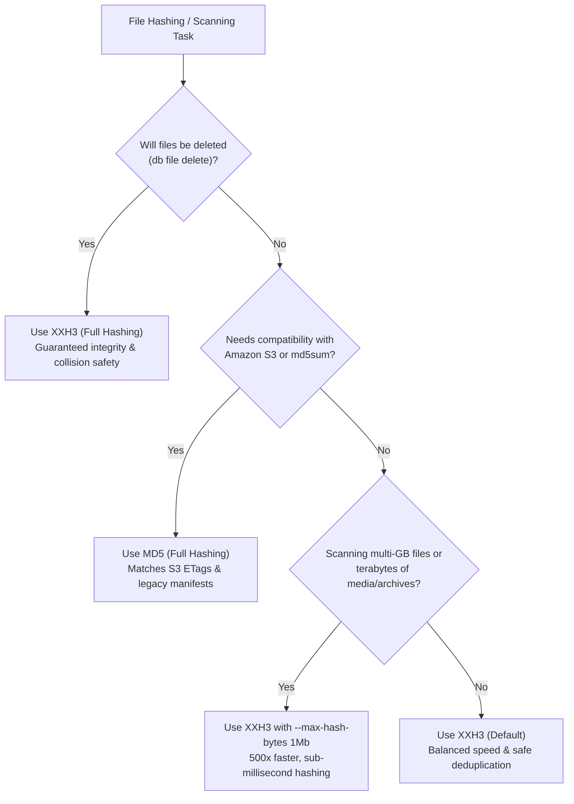

# Hashing Benchmark & Strategy Guide: XXH3 vs. CRC32 vs. MD5

This report benchmarks file hashing performance and trade-offs within Boveda across three primary hashing algorithms (**XXH3**, **CRC32**, and **MD5**) across varying file sizes (**100 MB**, **500 MB**, and **1,000 MB / 1 GB**) and `--max-hash-bytes` prefix limits (**Full**, **10Mb**, **1Mb**, **512Kb**, **256Kb**, and **64Kb**).

---

## 1. Executive Summary & Recommendation Matrix

| Metric / Requirement | **XXH3** *(Boveda Default)* | **CRC32** | **MD5** |
| :--- | :--- | :--- | :--- |
| **Bit Width & Digest Size** | 64-bit (16 hex chars) / 128-bit | 32-bit (8 hex chars) | 128-bit (32 hex chars) |
| **In-Memory CPU Throughput** | **2.66 GB/s** (4.2x MD5) | **4.01 GB/s** (6.3x MD5) | **0.63 GB/s** (1.0x baseline) |
| **1 GB Full File Latency** | **348 ms** | **239 ms** | **1,550 ms** *(Severe bottleneck)* |
| **1 GB File @ `--max-hash-bytes 1Mb`**| **0.69 ms** (~500x speedup) | **0.45 ms** (~530x speedup) | **2.16 ms** (~715x speedup) |
| **1 GB File @ `--max-hash-bytes 64Kb`**| **0.04 ms** (40 µs, ~8,700x speedup) | **0.04 ms** (45 µs, ~5,300x speedup) | **0.15 ms** (152 µs, ~10,200x speedup) |
| **Accidental Collision Safety** | **High** (~4.3 billion files for 50% risk) | **Dangerous** (~77,000 files for 50% risk) | **Virtually Zero** (~$1.8 \times 10^{19}$ files) |
| **Safe for `db file delete`?** | **Yes** (Recommended) | **NO** *(High risk of data loss)* | **Yes** |
| **Interoperability** | Native Boveda & Hash4j | ZIP/GZIP checksums | S3 ETags, rsync, md5sum |

---

## 2. Test Environment & Methodology

* **Processor**: AMD Ryzen 9 3900X 12-Core Processor (24 threads, 3.8 GHz base / 4.6 GHz boost, 64MB L3 cache)
* **Runtime**: OpenJDK 21.0.10 (64-Bit Server VM, mixed mode, sharing)
* **Filesystem & Storage**: Linux ext4 with warm OS page cache to isolate hashing CPU throughput from raw rotational/flash disk latency
* **Data Characteristics**: Deterministic pseudo-random bytes (non-zero byte arrays generated via PRNG) to avoid hardware/OS zero-page compression shortcuts
* **Timing Methodology**: Multi-iteration JVM warmups to ensure C2 JIT compilation; measured via monotonic `System.nanoTime()`

---

## 3. Pure Algorithmic Throughput (In-Memory 64 MB Buffer)

This phase eliminates all storage I/O, file handle overhead, and filesystem metadata to evaluate pure computational throughput on contiguous byte buffers:

| Algorithm | Implementation | Throughput | Relative Speed |
| :--- | :--- | :--- | :--- |
| **`CRC32C`** *(Castagnoli)* | `java.util.zip.CRC32C` (Hardware intrinsic) | **4.73 GB/s** | **7.5x** |
| **`CRC32`** *(IEEE 802.3)* | `java.util.zip.CRC32` (PCLMULQDQ hardware intrinsic) | **4.01 GB/s** | **6.3x** |
| **`XXH3`** *(64-bit)* | `com.dynatrace.hash4j.hashing.Hashing.xxh3_64` | **2.66 GB/s** | **4.2x** |
| **`MD5`** | `java.security.MessageDigest.getInstance("MD5")` | **0.63 GB/s** | **1.0x** |

> [!NOTE]
> `CRC32` and `CRC32C` leverage hardware-level carry-less multiplication (`PCLMULQDQ` / SSE4.2 CRC instructions) exposed as HotSpot JVM intrinsics, enabling speeds above 4 GB/s on a single core. `XXH3` is implemented in vector-friendly pure Java with outstanding diffusion and bit mixing, reaching 2.66 GB/s. `MD5` involves 64 complex nonlinear rounds per 64-byte block, capping single-core throughput at ~630 MB/s.

---

## 4. Large File Benchmarks across `--max-hash-bytes`

### 4.1 Full File Hashing (No Prefix Limits)

When hashing the entire contents of large files, throughput directly reflects the algorithm's CPU processing speed:

| File Size | Algorithm | Latency (avg) | Latency (min) | Processing Rate |
| :--- | :--- | :--- | :--- | :--- |
| **100 MB** | `XXH3` | **33.67 ms** | 31.33 ms | 2.90 GB/s |
| | `CRC32` | **24.74 ms** | 22.47 ms | 3.95 GB/s |
| | `MD5` | **163.53 ms** | 157.90 ms | 611.50 MB/s |
| **500 MB** | `XXH3` | **180.10 ms** | 173.09 ms | 2.71 GB/s |
| | `CRC32` | **122.80 ms** | 111.24 ms | 3.98 GB/s |
| | `MD5` | **829.50 ms** | 789.40 ms | 602.77 MB/s |
| **1,000 MB (1 GB)** | `XXH3` | **348.17 ms** | 338.72 ms | 2.80 GB/s |
| | `CRC32` | **238.99 ms** | 227.55 ms | 4.09 GB/s |
| | `MD5` | **1,549.58 ms** | 1,530.48 ms | 645.33 MB/s |

> [!WARNING]
> On a modern NVMe SSD capable of 3,500–7,000 MB/s read speeds, **MD5 creates a severe 600 MB/s CPU bottleneck**. Scanning 1 TB of data with full MD5 hashing will take at least **27 minutes of pure CPU hashing time**, whereas `XXH3` finishes in **6 minutes** and `CRC32` in **4 minutes**.

---

### 4.2 Impact of `--max-hash-bytes` on a 1,000 MB (1 GB) File

Boveda incorporates the full `fileSize` alongside the initial `N` bytes when `--max-hash-bytes` is set (`stream.putLong(fileSize)`). The table below demonstrates the speedups achieved on a 1 GB file:

| `--max-hash-bytes` Limit | Algorithm | Latency (avg) | Latency (min) | Effective Rate | Speedup vs. Full |
| :--- | :--- | :--- | :--- | :--- | :--- |
| **Full File (1,000 MB)** | `XXH3` | **348.17 ms** | 338.72 ms | 2.80 GB/s | 1.0x |
| | `CRC32` | **238.99 ms** | 227.55 ms | 4.09 GB/s | 1.0x |
| | `MD5` | **1,549.58 ms** | 1,530.48 ms | 645.33 MB/s | 1.0x |
| **`10Mb` (10,485,760 B)** | `XXH3` | **4.98 ms** | 3.34 ms | 195.97 GB/s | **70x faster** |
| | `CRC32` | **3.08 ms** | 2.55 ms | 316.91 GB/s | **78x faster** |
| | `MD5` | **15.82 ms** | 14.92 ms | 61.72 GB/s | **98x faster** |
| **`1Mb` (1,048,576 B)** | `XXH3` | **0.69 ms** (687 µs) | 605.14 µs | 1,420.47 GB/s | **507x faster** |
| | `CRC32` | **0.45 ms** (451 µs) | 349.01 µs | 2,161.16 GB/s | **529x faster** |
| | `MD5` | **2.16 ms** | 1.64 ms | 451.80 GB/s | **717x faster** |
| **`512Kb` (524,288 B)** | `XXH3` | **0.25 ms** (250 µs) | 210.75 µs | 3,903.83 GB/s | **1,392x faster** |
| | `CRC32` | **0.20 ms** (200 µs) | 179.92 µs | 4,858.77 GB/s | **1,189x faster** |
| | `MD5` | **0.92 ms** (921 µs) | 858.21 µs | 1,059.92 GB/s | **1,684x faster** |
| **`256Kb` (262,144 B)** | `XXH3` | **0.17 ms** (173 µs) | 129.27 µs | 5,619.68 GB/s | **2,003x faster** |
| | `CRC32` | **0.12 ms** (118 µs) | 110.82 µs | 8,218.00 GB/s | **2,011x faster** |
| | `MD5` | **0.60 ms** (601 µs) | 409.77 µs | 1,623.97 GB/s | **2,577x faster** |
| **`64Kb` (65,536 B)** | `XXH3` | **0.04 ms** (40 µs) | 37.84 µs | 24,350.39 GB/s | **8,704x faster** |
| | `CRC32` | **0.04 ms** (45 µs) | 39.91 µs | 21,768.05 GB/s | **5,327x faster** |
| | `MD5` | **0.15 ms** (152 µs) | 117.49 µs | 6,423.84 GB/s | **10,193x faster** |

---

### 4.3 Latency Progression Across Limits (1 GB File)

```mermaid
flowchart TD
    subgraph Full Hashing: Heavy I/O & CPU Bound
      F_MD5["MD5: 1,550 ms"]
      F_XXH3["XXH3: 348 ms"]
      F_CRC32["CRC32: 239 ms"]
    end

    subgraph Moderate Prefix: 10Mb
      M10_MD5["MD5: 15.8 ms"]
      M10_XXH3["XXH3: 5.0 ms"]
      M10_CRC32["CRC32: 3.1 ms"]
    end

    subgraph Optimal Sweet Spot: 1Mb
      M1_MD5["MD5: 2.16 ms"]
      M1_XXH3["XXH3: 0.69 ms"]
      M1_CRC32["CRC32: 0.45 ms"]
    end

    subgraph Ultra Fast Prefix: 64Kb
      K64_MD5["MD5: 152 µs"]
      K64_XXH3["XXH3: 40 µs"]
      K64_CRC32["CRC32: 45 µs"]
    end

    Full Hashing --> Moderate Prefix
    Moderate Prefix --> Optimal Sweet Spot
    Optimal Sweet Spot --> Ultra Fast Prefix
```

---

## 5. End-to-End CLI Scan Benchmark (`boveda scan`)

In this test, `boveda scan` scanned a directory containing 150 MB of test data (multiple 50 MB files, including duplicates), persisted snapshot metadata to H2, and computed duplicate rankings:

| Algorithm | `--max-hash-bytes` | Total End-to-End Scan Time | Primary Bottleneck |
| :--- | :--- | :--- | :--- |
| **`XXH3`** | `full` | **140.24 ms** | Hashing & Disk I/O |
| **`CRC32`** | `full` | **92.19 ms** | Disk I/O |
| **`MD5`** | `full` | **281.96 ms** | CPU (MD5 hashing rounds) |
| **`XXH3`** | `1Mb` | **64.07 ms** | Database transaction & index commits |
| **`CRC32`** | `1Mb` | **50.92 ms** | Database transaction & index commits |
| **`MD5`** | `1Mb` | **69.46 ms** | Database transaction & index commits |
| **`XXH3`** | `64Kb` | **56.34 ms** | Database transaction & index commits |
| **`CRC32`** | `64Kb` | **40.63 ms** | Database transaction & index commits |
| **`MD5`** | `64Kb` | **50.75 ms** | Database transaction & index commits |

> [!TIP]
> Notice that when `--max-hash-bytes` is set to `1Mb` or `64Kb`, the execution times for all three algorithms converge around **40 ms – 70 ms**. Because hashing only reads a few kilobytes per file, the hashing phase becomes nearly instantaneous, leaving database transactions and directory traversal as the sole remaining cost.

---

## 6. Comprehensive Circumstance Guide: Which Option to Use When?

### Circumstance A: General Deduplication & Default CLI Usage
* **Recommended Choice**: **`--algorithm XXH3`** with default full hashing (or `--max-hash-bytes 1Mb` for large storage).
* **Why**:
  * XXH3 provides 64-bit entropy ($1.8 \times 10^{19}$ possible states). Accidental collisions require billions of files under the Birthday paradox.
  * It delivers **2.7–3.0 GB/s** full file throughput, more than 4x faster than MD5, keeping up with fast NVMe drives.
  * It is 100% safe for deduplication reports and space auditing.

---

### Circumstance B: Safe Permanent File Deletion (`db file delete`)
* **Recommended Choice**: **`--algorithm XXH3`** with **full file hashing** (`--max-hash-bytes` omitted).
* **Avoid**: **DO NOT USE `CRC32`**.
* **Why**:
  * `CRC32` produces only a 32-bit checksum. Under the Birthday paradox:
    $$P(\text{collision}) \approx 1 - e^{-\frac{n^2}{2 \times 2^{32}}}$$
    At just **77,000 files**, there is a **50% probability of an accidental hash collision between completely different files**.
  * If CRC32 is used with `db file delete`, two distinct files with colliding checksums will be recognized as "duplicates", leading to irreversible deletion of non-duplicate user data!
  * Full file hashing ensures that files with identical initial headers (e.g. ISOs, container files) are verified byte-for-byte before deletion.

---

### Circumstance C: Terabyte-Scale Media, Video, and Archive Repositories
* **Recommended Choice**: **`--algorithm XXH3 --max-hash-bytes 1Mb`** (or `256Kb`).
* **Why**:
  * Full hashing of multi-gigabyte video or archive files forces the OS to read hundreds of gigabytes from disk, thrashing disk caches and degrading scan performance to tens of minutes.
  * Incorporating the **file size** plus the first **1 MB** distinguishes files almost universally: video and audio files with different content have different exact byte lengths down to the byte.
  * Drops hashing time on a 1 GB file from **350 ms down to 0.69 ms** (a **500x speedup**), making directory scans nearly instantaneous.

---

### Circumstance D: Cloud, Amazon S3, & Legacy Tooling Interoperability
* **Recommended Choice**: **`--algorithm MD5`** (with full hashing).
* **Why**:
  * Amazon S3 ETags for non-multipart uploads are the exact MD5 hex digest of the object.
  * Legacy systems, Linux utilities (`md5sum`, `rsync --checksum`), and file distribution manifests standardly publish MD5 hashes.
  * If Boveda snapshots need to be cross-referenced or validated against existing S3 object stores or external MD5 manifests, MD5 is the required choice despite its slower hashing speed.

---

### Circumstance E: Embedded, Battery-Constrained, or Low-Power Hardware
* **Recommended Choice**: **`--algorithm CRC32`** or **`--algorithm XXH3 --max-hash-bytes 64Kb`**.
* **Why**:
  * Low-power CPUs (e.g. Raspberry Pi, low-power NAS devices, laptops on battery) spend significantly more energy calculating MD5 cryptographic rounds.
  * `CRC32` utilizes hardware CPU instructions that draw minimal power, while `--max-hash-bytes 64Kb` minimizes storage read cycles and battery drain.

---

## 7. Summary Decision Matrix



---

## Referenced Files
* Benchmark execution test: [HashBenchmarkTest.kt](src/test/kotlin/com/cherba29/boveda/benchmark/HashBenchmarkTest.kt)
* Hasher implementation: [FileHasher.kt](src/main/kotlin/com/cherba29/boveda/hash/FileHasher.kt)
* Scan CLI command: [Scan.kt](src/main/kotlin/com/cherba29/boveda/cmds/Scan.kt)
